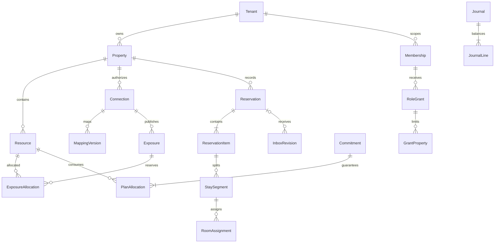

17 سبتمبر 2026 (P12-04 إصلاح F-RVW12-01..03): أُضيف جدول `platform_onboarding_request`
(مفتاح Idempotency عالمي للـonboarding: `idempotency_key` فريد + `fingerprint` SHA-256 لمحتوى
الطلب المطبع + `response` jsonb + `tenant_id`، مع FORCE RLS وسياسة `platform_access` ومنح
API select/insert فقط)؛ فأصبح `OnboardPlatformTenant` يعيد النتيجة المخزنة للمفتاح نفسه
بالمحتوى نفسه، ويرفض المفتاح نفسه بمحتوى مختلف بـ`IDEMPOTENCY_CONFLICT` (409) بلا أثر جديد،
وذرّياً تحت السباق (قيد فريد + replay/رفض fail-closed). وحُصنت ثماني دوال security definer
(`platform_create_tenant`، `platform_lifecycle_snapshot`، `platform_set_tenant_status`،
`platform_stop_tenant_sales`، `platform_resume_tenant_sales`، `platform_record_tenant_audit`،
`platform_support_tenant_profile`، `platform_support_tenant_audit`) باشتراط تطابق `p_actor`
مع سياق الجلسة `app.platform_user_id` إضافةً إلى فحص `is_active_platform_staff`، فيُرفض
الاستدعاء المباشر بـ42501 حتى بفاعل منصة نشط بلا سياق مصادق. التفاصيل
[docs/execution/P12-04.md](execution/P12-04.md).

17 سبتمبر 2026 (P12-03): أُضيفت دالتا دعم مؤقت محكومتان `platform_support_tenant_profile` و
`platform_support_tenant_audit` (security definer): تعيدان التحقق في القاعدة من فاعل منصة نشط
ومن وجود منحة `platform_support_grant` سارية (`starts_at <= now() < expires_at` وبلا سحب) تحمل
النطاق المطلوب (`tenant.read` أو `audit.read`)، وترفضان الاستدعاء المباشر بـ42501 بلا منحة؛
فقراءة سجل `tenant` أو `audit_event` من مسار المنصة لا تتم إلا بمنحة مبررة محددة الصلاحيات
والمدة (SEC-006). تُمنح `execute` لدور التشغيل فقط، ولا يُمنح أي وصول مباشر لجدول `tenant`
لموظفي المنصة. التفاصيل [docs/execution/P12-03.md](execution/P12-03.md).

17 سبتمبر 2026 (P12-02): أُضيف `platform_lifecycle_event` (سجل دورة عميل append-only بأنواع
ONBOARDED/SUSPENDED/REACTIVATED/CLOSED، وsnapshot تجميعي بلا بيانات نزلاء، ومفتاح idempotency
فريد لكل Tenant، وجمود بـtrigger وFORCE RLS وسياسة قراءة للمستأجر)، وعمود `tenant_slug` فريد على
`platform_subscription`، وعمود `sale_restriction.platform_stop`، وخمس دوال security definer
محكومة بفاعل منصة نشط: `platform_create_tenant` (إنشاء Tenant بلا منح INSERT لدور التشغيل)،
و`platform_lifecycle_snapshot` (عدّادات تجميعية فقط)، و`platform_set_tenant_status` (آلة انتقال
ACTIVE⇄SUSPENDED→CLOSED)، و`platform_stop_tenant_sales`/`platform_resume_tenant_sales`
(Stop Sell موثق على التعرضات النشطة). `selectTenant` يرفض منشأة غير ACTIVE بـ
`TENANT_STATE_CONFLICT`. التفاصيل [docs/execution/P12-02.md](execution/P12-02.md).

17 سبتمبر 2026 (P12-01): أُنشئت جداول ملكية المنصة `platform_staff` (مسؤول/دعم بلا عضوية منشأة،
`is_active_platform_staff()` security definer)، و`platform_plan` و`platform_plan_policy_version`
(إصدارات سياسة مؤرخة append-only: لا update/delete لدور التشغيل، trigger جمود، وقيد
`effective_from >= created_at::date` يرفض الأثر الرجعي)، و`platform_subscription` (اشتراك واحد
لكل Tenant + version + لقطة سياسة)، و`platform_entitlement`/`platform_entitlement_event`
(حالة + سجل مؤرخ لا يمحو التاريخ)، و`platform_usage_counter`/`platform_usage_event`
(عدّاد used/limit_value ومفتاح idempotency فريد لكل Tenant/مقياس)، و`platform_invoice`/
`platform_invoice_line` (فوترة إدارية بعملة واحدة وترقيم `PINV-` وتسوية يدوية بمرجع بلا بوابة
دفع)، و`platform_audit_event` (تدقيق منصة بلا قراءة مستأجر)، و`platform_support_grant`
(منحة دعم مؤقتة محددة النطاقات والمدة). مع FORCE RLS على الجميع: سياسة `platform_access` عبر
`app.platform_user_id`، وسياسة `tenant_read` (select فقط) لجداول الاشتراك/الاستحقاق/العدّاد/
الفاتورة/منحة الدعم، وtrigger منع تغيير tenant_id. دالتان ذريتان: `platform_consume_usage`
(فرض الحد داخل قاعدة البيانات تحت سباق) و`platform_record_tenant_audit` (مرآة تدقيق المستأجر
بتحقق من فاعل المنصة). وُسّع `tenant.status` ليشمل CLOSED. لا كتابة من مسار المنصة في
`journal`/`business_day`/`folio_charge`. التفاصيل [docs/execution/P12-01.md](execution/P12-01.md).

16 سبتمبر 2026 (P11-04 إصلاح F-RVW11-01..03): أُصلح مسار Pickup ليجلب طرف «الآن» بـ`departure >= from` بلا سقف (تماثلاً مع لقطة `departure >= reference_date`) ويبقى التقاطع مع الفترة موحداً في `pickupRows`؛ وإدراج `report_snapshot` صار `on conflict on constraint "report_snapshot_reference_unique" do nothing` مع إرجاع اللقطة الفائزة `replayed=true` بدل 500 عند التزامن. وفي SETTLEMENTS أُصبحت `folio_refund` و`cashier_session` تُرشّحان بنافذة نصف مفتوحة `[from,to)` بتوقيت المنشأة (`created_at >= from::date::timestamp at time zone tz` و`created_at < to::date::timestamp at time zone tz`) بدل `created_at::date` بتوقيت UTC وبطرف أعلى شامل (كان `to + 1 day`). **حد V1 معلن:** الجدولان لا يخزنان `business_date`، فالأساس هو اليوم المحلي للمنشأة المشتق من `created_at`، والربط الفعلي بيوم العمل مؤجل؛ والتقارير المالية الأخرى تبقى على `business_date`. التفاصيل في [docs/81](81_phase11_fix_session.md).

16 سبتمبر 2026 (P11-01..P11-03): أُنشئت جداول ملكية التقارير `report_snapshot` (لقطة Pickup واحدة لكل Tenant/Property/تاريخ مرجعي، بيانات jsonb ومرجع العضوية، FORCE RLS ومراجع مركبة ومنح API insert/select فقط بلا update/delete) و`report_export` (تصدير CSV خاص قصير العمر TTL=15د بحالات PENDING/RUNNING/READY/FAILED/EXPIRED/REVOKED، request jsonb، content/‏content_sha256/row_count/byte_size، lease_owner/lease_expires_at/attempt، created_by_membership/session وcorrelation، FORCE RLS ومراجع مركبة ومنح أقل صلاحية: API select/insert/update وworker select/update)، مع دالة `report_export_work_tenants()` (security definer) لاكتشاف عمل التصدير. تُعرض اللحظات في النقل RFC 3339 (`toIsoInstant`) لا بصيغة PostgreSQL الخام. صلاحيات `report.operational.view`/`report.financial.view`/`report.export` أُضيفت للكتالوج والأدوار النظامية (TENANT_OWNER/TENANT_ADMIN والثلاثة، وAUDITOR القراءة فقط). التقارير كلها قراءة فقط من قاعدة التشغيل؛ لا تعديل على journal/business_day/folio_charge/night_audit_*.

16 سبتمبر 2026 (P10-01..P10-03): أُنشئت جداول ملكية التدقيق الليلي `night_audit_run` (تشغيل واحد لكل Tenant/Property/BusinessDate بحالات PENDING/RUNNING/VALIDATION_FAILED/FAILED/SUCCEEDED وqlease/attempt/result ومرجع عضوية المسؤول)، و`night_audit_step` (خطوة واحدة لكل property/date/step_key مع checkpoint jsonb وattempts وحالات PENDING/RUNNING/DONE/FAILED/SKIPPED)، و`night_audit_exception` (BLOCKING/WARNING؛ OPEN ⇔ بلا سبب؛ ACKNOWLEDGED ⇒ مالك قابل للتتبع؛ RESOLVED تلقائياً عند زوال الشرط)، و`night_audit_event` (سجل تشغيل بقيم آمنة) مع FORCE RLS ومراجع مركبة Tenant/Property وtrigger منع تغيير tenant. استُخدمت سلسلة `business_day` كاملة OPEN→AUDIT_PREPARING→AUDIT_VALIDATION→CLOSING→CLOSED، ووُسّع `journal_postable_guard` (بمهاجرة جديدة) ليسمح بالترحيل في حالات ما قبل الإغلاق ويرفض CLOSING/CLOSED فقط. صلاحيات العامل: `update` على `property` (لقفل الصف قبل أي كتابة) و`insert` على business_day/journal/journal_line/folio_charge/audit_event وقراءة جداول التدقيق، وبلا update/delete على أي سجل مالي منشور؛ ودالة `night_audit_work_tenants()` (security definer) لاكتشاف العمل. لا reopen ليوم مغلق (D-13).

16 سبتمبر 2026 (P09-03): أُنشئت `ops_shift_handover` (عدّادات لحظية + مرجع `cashier_session` بلقطة لا تستبدل الدفتر)، و`ops_notification`/`ops_notification_receipt` (إشعارات داخلية بأنواع محددة وإيصالات قراءة لكل عضوية) مع FORCE RLS ومراجع مركبة، وبثّ إشعارات الطوارئ/الفحص/التسليم داخل معاملاتها، وإضافة `resource_code` لعرض المهمة/أمر العمل. الواجهة والبصريات `visual:phase9` 28/28.

16 سبتمبر 2026 (P09-01): أُنشئت `ops_task` (HOUSEKEEPING/GUEST_REQUEST بحالات PENDING→ASSIGNED→IN_PROGRESS→CLEAN→INSPECTED، ومرجع `source_event_id` فريد جزئياً لحدث المغادرة/النقل، ونسخة سياسة ولقطة موعد) و`ops_dnd_log` (ACTIVE→FOLLOWED_UP) و`property_operations_policy` (فحص إلزامي + فاصل تنظيف الإقامات الطويلة بنسخة) مع FORCE RLS ومراجع مركبة Tenant/Property ومفتاح مورد/بند/حجز/عضوية، وأُضيفت `CLEANING` إلى قيد `resource.housekeeping_state` وصلاحيات `task.read/task.manage/task.complete/task.inspect`. المهمة تُستهلك مرة واحدة لكل حدث `stay_event` وتُثبت بأثر قاعدة البيانات؛ work order/تسليم الوردية P09-02/P09-03.

15 سبتمبر 2026 (إصلاح F-RVW8-01..03 بعد [docs/67](67_phase8_independent_review.md)؛ [docs/68](68_phase8_fix_session.md)): بلا تغيير مخطط وبلا مهاجرة. (1) `balance_due` يشمل الآن أيضاً أثر **الإشعارات الدائنة** المنشورة لصالح فواتير الحساب ضمن `adjustments_total` (الذمة تقرأ كل قيود `FOLIO_GUEST` المرتبطة بالحساب من وقائع الدفتر)، ويبقى Credit Note «تصحيح فاتورة وليس Refund»؛ وإصدار الإشعار حركة مالية تعيد CLEARED إلى PENDING مثل العكس/التسوية تماماً (`finance.clearance_reopened`). (2) كل كائن `money` يحمل عملة معلنة يُفحص مقابل عملة المستند (`money/gross/commission/tax/unit` وتخصيصات التوجيه) ويُرفض mismatch بـ`INVALID_REQUEST/currency_mismatch` بلا أي تحويل (D-11/D-14). (3) `updateReservationCheckoutState` يصفّر أدلة الحسم عند إعادته PENDING. لا قرار D جديد ولا جمع عملات.

15 سبتمبر 2026 (P08-05..P08-06): في P08-05 أُنشئت `invoice_counter`/`folio_invoice`/`folio_credit_note`/`cashier_session` (تسلسل لا يتكرر، جمود، بوابة EX-03). وفي P08-06 أُضيفت أعمدة `reservation.financial_cleared_at/financial_clearance_basis/financial_clearance_reference/financial_clearance_payer_folio_id` بقيد دليل (`CLEARED ⇔ cleared_at` و`TRANSFER_TO_PAYER ⇒ دافع COMPANY + مرجع خطة`) وFK مركب إلى `folio` وفهرس PENDING، بلا تعديل النموذج المالي: CLEARED من دفع/استرداد فعلي أو تحويل ذمة موثق (D-13)، وأي حركة مالية لاحقة تعيده PENDING. حساب `balance_due` صار يشمل أثر قيود العكس/التسوية (`adjustments_total`)، وأُضيفت عمليتا `GetReservationClearance`/`SettleClearance` (`folio.read`/`folio.charge`) و`ListExternalSettlements` (`folio.read`) رابطة تسوية OTA بالحجز الخارجي بلا FX، مع منح قراءة `distribution_external_booking` لدور API (كتابة worker فقط).

15 سبتمبر 2026 (P08-04): أُنشئ `folio_refund` (RESERVED/PENDING/SUCCEEDED/FAILED، اعتماد مستقل، حد مجموع غير فاشل ≤ التحصيل بـtrigger مؤجل، قيد واحد لكل استرداد) و`fx_snapshot` (لقطة سعر باعتماد مستقل، واحدة لكل اعتماد)، وأُضيف `journal.adjusts_journal_id` مع فهرس `journal_reversal_once` للعكس الواحد؛ صلاحيتا `payment.refund.request` و`folio.adjust` (MFA)، وعمليات Phase 8 (25).

15 سبتمبر 2026 (P08-03): أُنشئ `folio_payment` (CASH/BANK_TRANSFER/OTA_SETTLEMENT/EXTERNAL_POS، حالة UNKNOWN/SUCCEEDED/FAILED، فصل gross/net/commission بقيد رياضي، مصدر فريد، ربط Journal عند النجاح فقط) مع trigger انتقال أمامي وFORCE RLS، وصلاحية `payment.record` وحساب `COMMISSION_EXPENSE`، وأُضيفت إجماليات الدفع لـ`GetFolio`؛ عمليات Phase 8 (18).

15 سبتمبر 2026 (P08-02): أُنشئت جداول الحسابات (`folio`, `folio_charge` بلقطة ضريبة ومصدر فريد، `payer_allocation` بتوجيه لا يضاعف الإيراد) والفوترة الدورية والباقات (`charge_schedule`, `package_entitlement`, `package_consumption`) والودائع (`folio_deposit` التزاماً لا إيراداً، `deposit_application`) مع FORCE RLS ومراجع Tenant/Property وثلاثة triggers مؤجلة تمنع تجاوز التوجيه/الاستهلاك/التطبيق، وصلاحية `folio.charge`، وعمليات Phase 8 (14). الدفع/التحصيل P08-03 والاسترداد P08-04 والفاتورة/الصندوق P08-05.

15 سبتمبر 2026 (P08-01): أُنشئت جداول المالية التشغيلية الأساسية `business_day` (يوم واحد نشط لكل منشأة بفهرس فريد جزئي، آلة حالة أمامية فقط، ومنع إعادة فتح مغلق) و`journal`/`journal_line` (دفتر ثنائي القيد متوازن لكل عملة وفق D-14: ست منازل وسيطة وترحيل منزلتين HALF_UP لكل بند مع سطر `ROUNDING_DIFFERENCE` معلن؛ قيد `UNIQUE (tenant, property, source_type, source_id)` للمصدر؛ trigger مؤجل يثبت توازن السطور عند commit) مع FORCE RLS ومراجع Tenant/Property، وحاجز ترحيل بقاعدة البيانات (`journal_postable_guard` يمنع الإدراج خارج اليوم المفتوح) وجمود المنشور (لا update/delete لدور التشغيل). صلاحيتا `folio.read` و`business_day.close` (MFA) وأحداث `finance.business_day_closed`/`finance.journal_posted`. Folio/Charge/Payment/Refund/Invoice/Cashier تبقى P08-02..P08-05.

15 سبتمبر 2026 (P07-01): أُنشئ `room_assignment` (نطاق زمني، GiST يمنع تراكب نفس الغرفة في PLANNED/ACTIVE، مراجع مركبة Item/Segment/Resource) و`stay_event` (append-only، unique لكل `tenant/property/item/type/item_version`) مع FORCE RLS، وأُضيفت `reservation_item.checked_in_at/checked_out_at` و`stay_segment.state/checked_in_at` و`reservation.financial_clearance_state` و`reservation_guest.departed_at`، وصلاحيات `frontdesk.read/assignment.manage/stay.checkin/stay.move/stay.checkout`.

15 سبتمبر 2026 (P07-02..05): بلا مهاجرات جديدة بعد `20260915140000`؛ استُخدمت `room_assignment`/`stay_event` والأعمدة أعلاه كما هي، وأنواع `stay_event` المنفذة: `STAY_CHECKED_IN/STAY_MOVED/STAY_EXTENDED/STAY_SPLIT/STAY_EARLY_DEPARTURE/STAY_PARTIAL_DEPARTURE/STAY_CHECKED_OUT` (حدث واحد لكل عملية بقيد `item_version`)، و`resource.housekeeping_state='DIRTY'` بعد Check-Out التشغيلي بلا لمس `maintenance_state`؛ P07-04/P07-05 واجهة وبصريات بلا تغيير مخطط.

14 سبتمبر 2026 (P06-02): `commitment` يحمل الآن نوع ITEM مرتبطاً ببند الحجز مع تخصيصات تُستبدل ذرياً عند التعديل (صف واحد لكل بند)، و`api_idempotency` يخزّن مفتاح العملية وبصمة الطلب والاستجابة الآمنة داخل نفس المعاملة.

14 سبتمبر 2026 (P06-01): نُفذت جداول `guest/reservation/reservation_item/stay_segment/reservation_guest` مع RLS ومراجع مركبة، واكتمل مرجع Reservation في `distribution_external_booking`/`distribution_inbox_revision` عبر FK مركب بنطاق Tenant/Property، والحالة الإجمالية مشتقة من البنود.

14 سبتمبر 2026 (P06-01): نُفذت جداول `guest/reservation/reservation_item/stay_segment/reservation_guest` مع RLS ومراجع مركبة، واكتمل مرجع Reservation في `distribution_external_booking`/`distribution_inbox_revision` عبر FK مركب بنطاق Tenant/Property، وحالة الحجز الإجمالية مشتقة من حالات البنود.

# عقد البيانات المنطقي المفصل

تحديث المرحلة 5 (14 سبتمبر 2026): أُنشئت جداول الأسعار (`rate_plan`, `rate_policy_version`, `nightly_price`, `price_quote`) وضمان المخزون (`commitment`, `plan_allocation` بقيد استبعاد GiST، `inventory_block`, `inventory_block_resource`, `inventory_disruption`) وحصص القنوات (`exposure`, `exposure_allocation` بقيد استبعاد، `sale_restriction`, `exposure_preview`) مع FORCE RLS ومراجع مركبة Tenant/Property، وأُضيفت صلاحيات `rate.manage`/`reservation.read`/`reservation.create`/`inventory.block`/`maintenance.emergency`/`channel.sale.manage`/`channel.reconcile`. Reservation/RoomAssignment تبقى للمرحلة 6.

تحديث المرحلة 4 (14 سبتمبر 2026): أُنشئت جداول المنشآت والموارد (`property_group`, `property`, `property_limits_profile` PERF-01, `resource_type`, `location`, `resource`) والمنتجات والمجموعات (`product`, `product_resource_candidate`, `inventory_pool`, `pool_member`) والتركيبات المؤرخة (`composition_version`, `composition_edge`, `composition_leaf` بتسطيح ذري) مع FORCE RLS وقيود مركبة على Tenant/Property، وربط `grant_property.property_ref` بمنشأة حقيقية. `RatePlan/NightlyPrice` وCommitment/Exposure تبقى لمرحلتي 5؛ حالة المورد المخزنية منفصلة عن `housekeeping_state` و`maintenance_state` (إدارتهما في 9).

تحديث المرحلة 3 (13 سبتمبر 2026): أُنشئ نموذج الهوية والعضوية فعلياً في 13 جدولاً (`app_user`, `auth_session`, `auth_flow`, `tenant`, `membership`, `permission`, `role`, `role_permission`, `role_grant`, `grant_property`, `invitation`, `approval_request`, `audit_event`) مع كتالوج صلاحيات ثابت وأدوار نظامية. مراجع Tenant المركبة `(id, tenant_id)` تمنع العلاقات عبر العملاء، وFORCE RLS على 20 جدولاً (بما فيها 11 جدول distribution) مع منع تغيير `tenant_id`. Property/Product/RatePlan/Reservation تبقى لمراحلها وفق سجل التبعيات.

تحديث المرحلة 2 (13 سبتمبر 2026): أُنشئت بنية تحتية القنوات فقط في 12 جدول `distribution_*` (Connection/Capability/Mapping/Inbox/Outbox/Attempts/Dedup/Checkpoint/Exception/DeadLetter) مع tenant_id/property_id كأعمدة بلا FK ومراجع مستقبلية معلنة، وفق docs/32 وسجل التبعيات. مهاجرة الإصلاح `20260913130000` أضافت `lease_token` لحجز Outbox و`ack_lease_owner/token/expires_at` و`ack_next_attempt_at` لحجز ACK الدائم، ومهاجرة `20260913140000` أضافت `ack_exception_id` لفصل ارتباط استثناء ACK عن `exception_id` الخاص باستثناءات المعالجة. لا جدول مخزون/حجز/مال/هوية منفذ؛ RLS ودور التشغيل مؤجلان إلى P03-03. قاعدة Keycloak منفصلة وتدير مخططها الخاص.

تحديث المرحلة 1: PostgreSQL محلي وأدوات MikroORM migrations موجودة؛ جدول التطبيق الوحيد الذي أنشأته الأدوات هو mikro_orm_migrations. لا كيان أو جدول من النموذج المنطقي أدناه منفذ. قاعدة Keycloak منفصلة وتدير مخططها الخاص؛ هذا لا يحقق عزل العميل أو صلاحيات التطبيق.

حالة: تصميم علاقات ومفاتيح وقيود، دون SQL أو قاعدة منشأة. يعتمد D-02/03/12/14/18/20؛ لا يحل مكان مراجعة migrations قبل التنفيذ.

## مفاتيح مشتركة

UUID داخلي لكل كيان، وversion عدد صحيح للتنافس. كل سجل تابع لعميل يحمل tenant_id، وكل سجل تشغيلي يحمل property_id. المراجع المركبة تتحقق من Tenant/Property مع id؛ وجود UUID عالمي لا يغني عن شرط النطاق. created_at/updated_at لحظات UTC، وBusinessDate وStayDate تواريخ محلية. الحقول المالية Decimal نصية في النقل، القيم الخارجية Strings لا تحول إلى أرقام.

| المالك والكيان | الحقول والعلاقات اللازمة | التفرد والقيود |
|---|---|---|
| Identity: User | identity_subject؛ 1:N Membership | subject مع issuer فريد؛ User ليس مالك Tenant تلقائياً |
| Membership | tenant_id/user_id/status/revoked_at/authz_version | زوج Tenant/User؛ النشط شرط كل وصول |
| Role / RolePermission | tenant_id/name؛ Role 1:N permissions | permission_code من الكتالوج لا نص من المتصفح |
| RoleGrant / GrantProperty | membership_id/role_id/effect/scope_type/expires_at؛ منشآت كل منح | TENANT منح صريح وليس قائمة فارغة ضمنية؛ PROPERTIES يتطلب قائمة غير فارغة؛ جميع المراجع في Tenant والنطاق مع الدور وحدة واحدة لا حاصل ضرب منح |
| Approval | actor/request_hash/resource_version/approver/status/expires_at | الطالب ليس المعتمد؛ الموافقة لا تنتقل لنسخة جديدة |
| Property | tenant_id/group_id?/timezone/base_currency/status/limits_profile_id/inventory_version | group داخل Tenant؛ timezone معتمد؛ تغيير الأساس المالي مضبوط |
| Resource / ResourceType | property/location/type/capacity/features/lifecycle | code فريد داخل Property؛ retired لا يمحو التاريخ |
| Product / ProductCandidate | property/type/occupancy_policy؛ موارد أو تركيبات مرشحة | لا مخزون مستقل لكل RatePlan أو meal plan |
| CompositionVersion / CompositionEdge | product_id/effective_from/effective_to؛ parent→child | بلا دورات أو تكرار ورقة، Property واحدة؛ نسخة مستخدمة ثابتة |
| Pool / PoolMember | Property ومعايير الموارد ونسخ العضوية | تجمع مرشحين فقط؛ لا مورد محاسبي إضافي |
| Reservation | source/channel_connection_id?/external_booking_key?/status | حجز Property واحدة؛ مفتاح خارجي ضمن الاتصال الأصلي |
| ReservationItem | reservation_id/product_id?/dates/occupancy/policy_snapshot | 1:N للحجز؛ product اختياري فقط للاستثناء الخارجي غير المربوط؛ التأكيد الداخلي يتطلبه؛ حالة مستقلة وإجمالي مشتق |
| ReservationGuest | item_id/guest_id/role | Guest في Tenant، وصول Property عبر العلاقة |
| StaySegment | item_id/dates/rate_snapshot/composition_version_id? | قطاعات دون فجوات غير معلنة أو تداخل لنفس البند |
| Commitment / PlanAllocation | source_kind/source_id/state/expires_at؛ 1:N موارد وفترات | source_kind واحد من Hold/Item/Group؛ لا تداخل allocations فعالة للمورد |
| RoomAssignment | segment_id/resource_id/start/end/locked/replaces_id? | تاريخ لا يستبدل؛ تطابق مع الخطة عند التسليم |
| InventoryBlock | property/resource_or_product/reason/start/end/state | أسباب متعددة مسموحة؛ planned conflict يرفض، emergency ينشئ Disruption |
| Exposure / ExposureAllocation | connection/product/period/state/epoch/cutoff؛ 1:N موارد | مورد/فترة لا يوزع في حصتين فعالتين؛ تحويل لحجز يحرر الحصة ذرّياً |
| SaleRestriction | property/connection?/product_or_rate/period/reason/active | Open يشير إلى restriction_id محدد؛ composite effective state مشتقة |
| Connection / CapabilityEvidence | provider/environment/external_property_id/secret_ref/status؛ قدرات مؤرخة | mapping الخارجي فريد داخل provider_account/environment؛ يمنع تعيينه لعميلين |
| MappingVersion | connection/external_room/external_rate/occupancy/internal_product/internal_rate/effective_at | غموض الربط يمنع التفعيل؛ يدعم عدة عروض سعر لنفس المورد |
| ExternalBookingLink | connection/ota_code/external_booking_id/reservation_id/provider_booking_id | يحتفظ به عند تبديل المزود؛ aliases تمنع استيراد الأصل مرتين |
| InboxRevision | provider_account/revision_id/safe_payload_ref/hash/status/reservation_id?/exception_id? | revision فريد في نطاق حساب المزود؛ hash مختلف لنفس revision تعارض |
| Outbox / SyncAttempt | aggregate_id/event/version/cell_keys/status/lease/task_id?/error | نشر حدث واحد منطقي؛ المحاولات متعددة؛ pending لا يعني وصول OTA |
| IdempotencyRecord | tenant/property/operation/key/request_hash/result_ref/status | نفس key ومحتوى مختلف 409؛ إعادة مصرح بها تعيد الأصل |
| ExceptionCase | property/connection?/revision?/type/owner/state/resolution | لا حذف لحقيقة حجز متعارض؛ كل حل مسبب ومؤرخ |
| RatePlan / NightlyPrice | product/currency/occupancy/meal/inclusions/policy_version/date | فريد داخل Property/خطة/تاريخ/إشغال؛ decimal دقيق |
| Folio / Charge / PayerAllocation | property/item?/payer/currency؛ charge source/value/policy | مجموع التوجيه يساوي الأصل؛ لا عبر Tenants |
| Journal / JournalLine | property/business_date/currency/source/reversal_of?؛ debit/credit/account | متوازن لكل Journal وعملة؛ المصدر فريد؛ منشور immutable |
| Payment / Refund / Settlement | currency/amount/external_ref/evidence/status/original_payment_id? | لا استرداد يتجاوز أصل التحصيل؛ تسوية ذات فرق معلن |
| FxSnapshot | pair/direction/rate/effective_at/source/approver | السعر المستخدم بالمستند ثابت؛ لا استبدال تلقائي |
| BusinessDay / AuditStep | property/date/state؛ step/checkpoint | يوم واحد مفتوح؛ خطوة واحدة لكل property/date/name |
| Invoice / CreditNote | property/series/number/source/policy/status | رقم فريد داخل السلسلة؛ سياسة محلية شرط الإصدار |
| Task / ShiftHandover | property/resource?/stay?/assignee/status | المهام لا تعدل حجوزات أو مالاً مباشرة |
| AuditEvent | tenant/property?/actor/action/resource/before_after_safe/at | كتابة فقط؛ لا أسرار أو PAN أو نص مراسلات خام |

علامة ? تعني علاقة اختيارية محددة الغرض، لا تجاوز Tenant. مرجع source_kind/source_id متعدد الأنواع يتحقق بقيد أو عقد مالك صريح قبل التنفيذ؛ لا foreign key وهمي إلى عدة جداول.

## العلاقات المركزية

الرسم يوضح العلاقات المركزية فقط؛ جدول الكيانات يحدد بقية العلاقات والاختيارية. Incoming revision غير معروف الربط يمكن أن يوجد قبل Reservation، والحجز الخارجي المتعارض يمكن أن يوجد دون Commitment ناجح.

## العزل والاستعلام والفهارس

دور التطبيق لا يملك الجداول ولا BYPASSRLS؛ FORCE RLS حيث يلزم لحماية مسارات المالك، ودور migrations منفصل لا يستخدمه API أو Worker. تعيين السياق transaction-local لا session-global؛ فشل تحديد Tenant يمنع الاستعلام. كيان الهوية المشترك لا يعطي وصولاً إلى عضويات Tenants أخرى.

فهارس مرشحة للتنفيذ: (tenant, property, status, arrival) لقائمة الحجوزات؛ (tenant, property, resource, period) للتداخل؛ (provider_account, revision_id) للتفرد؛ (tenant, property, status, next_attempt_at) للطوابير؛ (membership, role, property) للتفويض؛ (property, business_date, currency) للتقارير. تثبت EXPLAIN والقياسات الحاجة؛ لا تفرض فهارس بلا استعلام معروف.

قبل SQL: تحويل هذا العقد إلى ERD تنفيذي وقيود SQL ضمن تفويض البرمجة، اختبار جميع references العابرة للمنشآت، وتوثيق آلية قفل Exposure مع PlanAllocation لأن منع التداخل داخل جدول واحد لا يحمي جدولاً آخر. قفل Property يجمعهما في ضمان واحد.

## الاحتفاظ والهجرة

الأحداث المنشورة والمراجع المالية تحفظ وفق ملف السوق؛ Guest يمر بالتقليل والاحتفاظ لا حذف المراجع المالية. raw webhook يخضع لتنقية الحقول الحساسة قبل التخزين، وpayload_safe مشفر محدود الوصول؛ لا PAN/CVV في Inbox. الأسرار مجرد secret_ref. يحتفظ بمفاتيح منع التكرار وأسماء الحجوزات الخارجية عبر عمر الالتزام وفترة الاسترداد المثبتة بعقد المزود؛ لا TTL قصير يمحو حقائق المصدر.

استيراد البداية ينشئ ExternalBookingLink ونسخة مصدر ونتيجة مطابقة، لا يسجل cash قديم كدفعة جديدة. الأرصدة الافتتاحية قيد مستقل مع مرجع مصدر وموافقة. نسخ ERD المستقبلية لا تغير Tenant لسجل قائم بغرض نقل منشأة؛ النقل مشروع هجرة مستقل.
