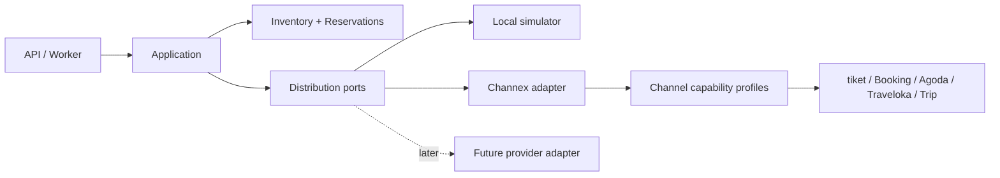

# عقد ربط قابل للتوسع

التاريخ: 13 سبتمبر 2026. تفصيل تنفيذي مقترح لـD-19/20 وCAP-13، دون تغيير قرارات المجال. يراجع ويحوّل إلى عقد TypeScript/OpenAPI عند P02-01. لا يمثل تنفيذ Adapter أو اعتماد قناة.

## الفصل المطلوب

`Provider` هو مسار التقنية مثل Channex أو ربط مباشر مستقبلي. `Channel` هو موقع البيع مثل tiket.com. `Connection` ربط حساب منشأة وقناة عبر مزود وبيئة محددين. `ProviderAccount` يحدد اعتماد المزود ونطاق وصوله الموثوق. لا تختزل هذه المفاهيم في حقل اسم قناة واحد.

V1 يستخدم Adapter واحداً لـChannex مع ملفات قدرات وربط منفصلة للقنوات الخمس؛ لا خمسة نسخ من منطق الشبكة. النواة تتعامل مع مفاهيمها الداخلية، والأسماء الخارجية والأخطاء وأشكال الرسائل تبقى في Adapter. حقول الإشغال والوجبة والضرائب والسعر مشتركة دلالياً؛ قواعد تمثيلها لدى القناة في profile مختبر. لا شروط `if booking.com` داخل محرك المخزون أو Journal.

## بنية محددة عند التنفيذ

داخل `packages/backend/src/modules/distribution`:

| الموضع المقترح | المسؤولية | ما لا يملكه |
|---|---|---|
| `domain` | هوية المصدر وحالات revision/sync وعقود القدرات ونتائج الترجمة | HTTP، أسرار، ORM، تخصيص غرف |
| `application` | سحب/حفظ/ACK، أوامر نشر ومطابقة وإعادة معالجة | تفسير raw خاص بقناة داخل الحجز |
| `persistence` | Inbox/Outbox/Mapping/Attempts/Links/Capabilities | كتابة جداول Inventory أو Finance مباشرة |
| `adapters/channex` | client والتحقق من payload والتطبيع وأخطاء/مهل/حدود المزود | تقرير أن الحجز قابل للإيواء |
| `adapters/simulator` | محاكاة deterministic وفشل وترتيب وتكرار | بيانات بديلة صامتة عن مزود إنتاجي |
| `adapters/channex/profiles` | الفروق المثبتة للقنوات الخمس | تعطيل ثابت حماية في النواة |

Registry ثابت في الكود يربط `provider_key` بـAdapter معروف. كتالوج القنوات قابل للإضافة بمعرفات نصية مستقرة وقيود تحقق، وليس enum مغلقاً في قاعدة البيانات يتطلب migration لكل اسم قناة. لا تحميل كود من URL أو حزمة يرفعها العميل. `provider_key` المختلف يتطلب Adapter واختبارات وإصداراً جديداً.

## عقد العمليات

المصدر الأساسي [عقد API](26_api_permissions_events.md). الأسماء أدناه للعقد الداخلي، وليست مسارات شبكة مخترعة. كل عملية تأخذ ConnectionContext موثوقاً، وdeadline وcorrelation ID؛ أسرار الحساب تحل داخل Adapter من secret_ref.

| العملية | المدخل والمعنى | النتيجة المطلوبة |
|---|---|---|
| `inspectCapabilities` | اتصال وبيئة وإصدار profile | أدلة مؤرخة لكل قدرة، لا تأهيل إنتاجي تلقائي |
| `inspectMappings` | اتصال معروف | قائمة معرفات ونسخ ومعنى إشغال/وجبة/عملة وخطط مشتقة |
| `pullRevisions` | cursor opaque مع نطاق حساب موثوق وحد صفحات | revisions مع هوية المصدر وcontinuation؛ cursor ليس timestamp مرتباً نفترضه |
| `acknowledgeRevision` | revision محفوظة وحالة معالجة مستديمة | قبول نقل/مجهول/رفض، منفصل عن حالة الإقامة |
| `pushAvailability` | snapshot مطلقة لخلايا نوع/تاريخ مع إصدار | نتيجة لكل خلية وrequest/task IDs ودقة التأكد |
| `pushRestrictions` | خلايا خطة/تاريخ تشمل السعر والقيود المدعومة | partial/accepted/rejected/unknown بحسب دليل الاستجابة |
| `readProviderState` | نطاق خلايا ومحاولة/إصدار | ما يعرفه المزود في وقت معين، لا ادعاء أنه طبق لدى OTA |
| `readChannelEvidence` | نطاق قناة ومحاولة | دليل القناة أو UNSUPPORTED/UNKNOWN، لا نجاح مصطنع |

دعم استرجاع الحجوزات القائمة يحدد في P02-01 كقدرة وعقد استيراد مستقل، مع مصدر واكتمال ونقطة استئناف؛ لا افتراض أن revision feed سجل تاريخي كامل. لا يضاف أمر عام لتعديل أو إلغاء حجز OTA حتى يثبت دعمه. الطلب غير المدعوم يبقى PendingExternal مع متابعة موظف وفق العقد الحالي.

النتيجة الموحدة تشمل `schema_version` و`provider_request_id?` و`provider_task_id?` و`observed_at` و`certainty` و`cell_results` و`retry_after?` و`safe_error_code?`. `certainty` يميز NOT_SENT وPROVIDER_ACCEPTED وCHANNEL_VERIFIED وPARTIAL وUNKNOWN وREJECTED؛ يضبط الفصل بين حالة النقل وحالة المهمة عند تقنين P02-01. غياب task ID أو readback ليس إقرار نجاح.

## الهوية والتطبيع

العقد الداخلي للـrevision يشمل: provider/environment/account، connection، channel_key، external booking ID كنص، provider booking/revision IDs، نوع new/modified/cancelled، مصدر ترتيب موثق إن وجد، received_at وsource time إن وجد، البنود والفترات والإشغال ونسخة الربط والمبالغ والعملة والوجبات والحقول المجهولة صراحة. تحفظ نسخة envelope وتقرير التنقية.

المفتاح المانع لتكرار revision يكون ضمن provider account والبيئة وهوية revision حسب عقد البيانات. تكرار المفتاح مع payload مختلف يعزل للمراجعة؛ timestamps وUUID لا يستخدمان كترتيب إصدار افتراضي. لا هوية دائمة لبند اعتماداً على موضعه في array. الحجز متعدد الغرف بلا هوية بنود مستقرة يحتاج مطابقة موثقة أو استثناء.

`ExternalBookingLink` يحتفظ بهوية OTA الأصلية وaliases المزود عند تغيير المسار؛ إعادة الاستيراد من مزود جديد لا تنشئ حجزاً ثانياً. لا merge بالاسم أو البريد وحده. لا يأخذ webhook tenant_id كسلطة؛ property الخارجية تحل من ربط مخول. معرف خارجي مجهول لا ينشئ Property أو Guest تلقائياً.

Money نص decimal، وغياب العمولة/الضرائب/net يظل UNKNOWN. لا استنتاج أن إجمالي OTA هو صافي التحصيل. تواريخ الليالي محلية وفترة النهاية غير شاملة داخلياً؛ يختبر Adapter حدود التاريخ بدل نسخ صيغة النطاق بين الأنظمة. لا يغير اختيار اللغة العملة أو timezone.

## دوام الرسائل والفشل

1. Webhook موثق المصادقة أو signal محدود السلطة والمعدل يجدول سحباً؛ Feed المصادق مصدر الرسالة وفق مسار Channex المعتمد.
2. تحقق الحجم والبنية، ثم إزالة بيانات البطاقات والأسرار والحقول غير اللازمة قبل حفظ payload الآمنة. لا raw body في log أو DLQ.
3. PostgreSQL يحفظ revision ومفتاح التكرار ونتيجة التطبيق أو الاستثناء القابل للاستئناف. لا ACK قبل اكتمال هذا الحفظ. فشل commit لا يصدر ACK.
4. ACK يعاد بالمفتاح الأصلي عند غموض النقل؛ لا ينشأ أثر حجز إضافي. حفظ الاستثناء لا يعني إيواء الضيف، ويظل قابلاً للمعالجة بعد ACK.
5. Outbox داخل معاملة التغيير مصدر نية الإرسال. BullMQ آلية تنفيذ قابلة لإعادة البناء من PostgreSQL؛ فقد Redis لا يفقد أحداث العمل.
6. عاملان لا ينشران زيادات متنافسة لنفس النطاق؛ lease وإصدار وحالة الطلب العالق. restart لا يجعل نسخة قديمة أحدث. لا شبكة OTA داخل معاملة قفل المخزون.
7. 429 يحترم Retry-After وحدود حساب المزود، مع عدالة بين المنشآت وbackoff محدود وjitter؛ validation permanent يذهب لمعالجة لا retry بلا نهاية. مهلة بعد إرسال محتمل تبقى UNKNOWN مع مطابقة قبل زيادة لاحقة.
8. إعادة DLQ تتطلب الصلاحية وسبباً وتدقيقاً، وتحافظ على revision/event الأصلي. يعاد التحقق من العضوية للأوامر البشرية، وتستخدم هوية خدمة منفصلة لاستقبال التزامات القنوات.

تصميم الدوام للمشروع لا يعد exactly-once على الشبكة؛ المطلوب أثر مجال واحد مع نقل قابل للتكرار. لا TTL قصير يحذف dedup بينما قد يعيد المزود إرسال المصدر؛ سياسة الاحتفاظ تتبع نافذة الاسترجاع وعمر الالتزام وتوثق قبل الإنتاج.

## مصفوفة قدرات قابلة للتدقيق

سجل كل قدرة على مستوى provider + adapter version + channel + environment + connection + نوع مورد/نموذج سعر عند تأثيرهما. الحقول: capability_code، DOCUMENTED/TESTED/UNSUPPORTED/UNKNOWN، authorization_status المستقلة، evidence URL/reference، checked_at، test_run_id، limitations، owner، recheck trigger. اختبار المحاكي لا يرفع خلية حساب حقيقي إلى TESTED.

الأساسية: new/modify/cancel inbound، Mapping، availability مطلقة، الأسعار، Open/Stop Sell، recovery، وتمثيل D-20 بما في ذلك فصل حصص القنوات ومنع إعادة الزيادة الخارجية والتحقق من السحب. readback الآلي قد يكون اختيارياً تقنياً، لكن **دليل السحب اللازم لـD-20 إلزامي**؛ إن تعذر آلياً يلزم إجراء تحقق بشري موثق ومطابقة، وإلا تبقى الحصة UNKNOWN.

الاختيارية: CTA/CTD وmin/max stay وOBP بحسب المنتج؛ تصبح إلزامية لهذا المنتج إذا كانت سلامة عرضه تعتمد عليها. قدرات المراسلات تسجل UNKNOWN/DEFERRED إن لم تثبت، ولا يبدأ صندوق مراسلات في هذه الحزم. إضافة capability لا تجعل الحساب مفوضاً بها.

## إضافة قناة لاحقاً

| المسار | العمل الإضافي | دليل القبول |
|---|---|---|
| قناة يدعمها Channex والعقد الحالي | تعريف catalog/profile، دلائل قدرات، Mapping، fixtures، تشغيل الحزمة المشتركة، ثم تفويض واختبار حساب | النواة بلا تغييرات أعمال، وAT-C لكل قدرة أساسية |
| قناة عبر مزود جديد | Adapter جديد يطبق ports، resolver للأسرار والهوية، ترجمة أخطاء وحدود واعتماد، aliases عند النقل | نفس conformance suite، عزل واستعادة وتبديل writer، ثم pilot |
| قدرة جديدة لا يمثلها العقد | وثيقة فرق ونسخة عقد متوافقة أو migration محددة، واختبارات المستهلكين الحاليين | القنوات الخمس لا تتراجع؛ القرار إذا غيرت ضمان D-20 أو نطاق V1 |

اختبار قابلية التوسع المحلي P02-06: إضافة profile اصطناعي `test-sixth-channel` في اختبار/محاكي فقط، وتشغيل نفس حالات mapping/revisions/ARI/errors دون تعديل Inventory/Reservations/Finance. لا يظهر في كتالوج الإنتاج ولا يعد قناة حقيقية سادسة مدعومة. اختبار Adapter بديل وهمي يثبت أن Application يعتمد port ولا يستورد Channex.

تغيير مزود اتصال حي يحتاج سحباً ومطابقة وcutover مع writer واحد. لا يكفي تغيير provider_key أو تفعيل كلا المزودين على المخزون نفسه. سهولة التوسع تعني حصر التغيير وعقداً قابلًا للاختبار، ولا تلغي اعتماد القناة ومتطلبات حساب المنشأة.

## أدلة عامة أعيدت قراءتها

الاطلاع: 13 سبتمبر 2026، صفحات عامة دون حسابات. هذه الروابط تثبت ما تصفه الوثائق، ولا تثبت أهلية عقدنا أو نجاح D-20:

- [Channex Bookings Collection](https://docs.channex.io/api-v.1-documentation/bookings-collection): feed للـPMS وهويات الحجز/revision وبنية الرسائل.
- [Channex ARI](https://docs.channex.io/api-v.1-documentation/ari): واجهة تحديث التوفر وقيود/أسعار الخطط؛ التنفيذ يراجع الإصدار الفعلي.
- [Channex PMS certification](https://docs.channex.io/api-v.1-documentation/pms-certification-tests): برنامج تحقق المزود، يضاف إلى اختبارات المنتج ولا يستبدلها.
- [Channex best practices](https://docs.channex.io/guides/best-practices-guide): مرجع ممارسات التكامل العامة عند تقنين Adapter.

هذه الأدلة تكمل [سجل الاتصال](22_connectivity_evidence.md) ولا تعيد تسعير خدمة أو تعلن حالة شراكة حالية.

## تحديث التنفيذ المحلي (P13، 17 سبتمبر 2026)

- conformance suite محلي يعمل على نفس عقد العمليات عبر المحاكي للقنوات الخمس + قناة سادسة
  اصطناعية: `tests/distribution/p13-conformance.test.mjs` و`scripts/p13-conformance.mjs`
  ([P13-03](execution/P13-03.md))؛ المحاكي لا يرفع خلية حساب حقيقي إلى TESTED.
- سجل تأهيل القنوات الخمس وقوالبه: [channel-readiness.json](execution/channels/channel-readiness.json)
  ([P13-04](execution/P13-04.md))؛ إضافة قناة لاحقاً تمر بالمسار نفسه ثم هذا العقد.
- في Cutover، المفتاح الخارجي غير المرتبط الوحيد يُتبنّى ذرياً مع تدقيق، وتعدد المرشحين
  `EXTERNAL_KEY_AMBIGUOUS` ([P13-05](execution/P13-05.md))؛ لا Adapter حي ولا اتصال مفوض بعد.
