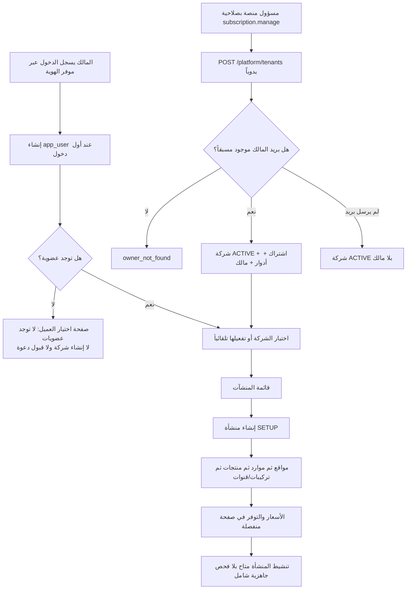
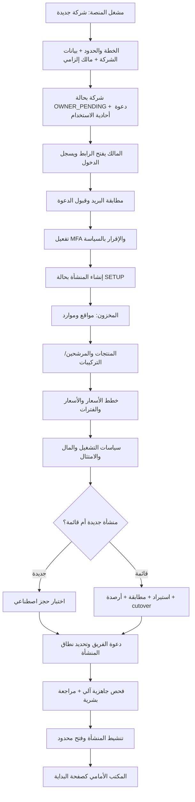

# تحليل رحلة إنشاء شركة جديدة وبدء استخدام HOTEL PMS

التاريخ: 20 سبتمبر 2026. نوع الوثيقة: **تحليل للحالة الفعلية وتوصية؛ لا تمثل تنفيذاً أو قراراً جديداً**.

## الحكم التنفيذي

النظام يملك معظم اللبنات الخلفية اللازمة لتهيئة عميل ومنشأة، لكنه لا يملك حتى الآن رحلة بدء متصلة يستطيع مالك شركة جديدة إكمالها من الواجهة.

- **التهيئة بمساعدة مشغل المنصة:** ممكنة تقنياً، لكن تحتاج استدعاء API يدوياً، وترتيباً خاصاً لدخول المالك أول مرة، ثم عملاً يدوياً عبر شاشات متفرقة.
- **التسجيل الذاتي لشركة جديدة:** غير منفذ.
- **بدء تشغيل منشأة حقيقية بأمان:** غير جاهز؛ لا توجد بوابة جاهزية قبل تنشيط المنشأة، وEX-01..05 وG-13 ما تزال حاكمة.
- **التوصية للـpilot:** رحلة موجهة بمساعدة فريق المنصة، مع مالك إلزامي ودعوة قابلة للقبول، ومعالج إعداد للمنشأة وبوابة جاهزية تمنع التفعيل المبكر. يؤجل التسجيل الذاتي والدفع الذاتي حتى حسم الخطط والأسعار والامتثال والمورد الخارجي.

المصطلح المقترح في الواجهة: **الشركة** للحساب التجاري `Tenant`، و**المنشأة** للفندق أو الفيلا أو المجمع `Property`. استخدام «العميل» مناسب للوحة مشغل المنصة، لكنه مربك لمالك الشركة داخل مساحته.

## ما يحدث فعلياً الآن

### القدرات الموجودة

1. الدخول عبر OIDC آمن، ويُنشئ سجل المستخدم عند أول دخول.
2. API المنصة ينشئ الشركة والاشتراك وإصدار السياسة والاستحقاقات والحدود والأدوار بصورة ذرية وidempotent ومدققة.
3. إذا كان `owner_email` لحساب موجود وفعال، تُنشأ عضوية المالك ويُمنح `TENANT_OWNER`.
4. إنشاء المنشأة موجود من الواجهة ويتطلب `property.manage` وMFA؛ تبدأ المنشأة في `SETUP`.
5. إعداد المواقع والموارد والمنتجات والمرشحين والتركيبات ومسودات القنوات موجود.
6. إعداد خطط الأسعار وتقويم الأسعار والتوفر والحصص موجود في وحدة منفصلة.
7. إدارة الأعضاء والأدوار والدعوات موجودة، وعملية قبول الدعوة موجودة في API.
8. الاستيراد والمحاكاة والمطابقة موجودة محلياً، لكن تشغيلها على بيانات حقيقية والربط الحي ما يزال خاضعاً للبوابات الخارجية.

### الأدلة من التنفيذ

| الدليل | النتيجة |
| --- | --- |
| `apps/web/src/identity/AuthPages.tsx:8-35` | شاشة الدخول تعرض «تسجيل الدخول» فقط؛ لا تسجيل شركة أو حساب جديد داخل المنتج. |
| `apps/web/src/identity/TenantSelectPage.tsx:31-37` | المستخدم بلا عضوية يرى رسالة تطلب دعوة من المسؤول ولا يملك فعلاً تالياً. |
| `apps/web/src/App.tsx:895-902` | لا يوجد route لتسجيل شركة أو قبول دعوة؛ مسارا الهوية هما login وcallback فقط. |
| `apps/api/src/platform/dto.ts:81-91` | عقد إنشاء الشركة موجود: name/slug/customer_label/plan_code وowner_email اختياري. |
| `packages/backend/src/modules/platform/application/lifecycle-service.ts:282-313` | ربط المالك ينجح فقط إذا كان بريده موجوداً مسبقاً في `app_user`؛ البريد اختياري. |
| `apps/web/src/api/platform.ts:85-149` | عميل الويب يسرد الشركات والخطط ويدير التعليق/الإعادة/الإغلاق، لكنه لا يعرّف عملية onboarding. |
| `apps/web/src/platform/PlatformPage.tsx:447-532` | لوحة المنصة تعرض دليل العملاء وإجراءات الدورة ولا تعرض زر «شركة جديدة». |
| `apps/api/src/identity/org.controller.ts:318-339` | قبول الدعوة منفذ في API. |
| `apps/web/src/identity/MembersPage.tsx:273-281,401-410` | رمز الدعوة الخام يظهر مرة واحدة للمسؤول؛ لا إرسال خارجي، ولا شاشة قبول للمستلم. |
| `apps/web/src/property/PropertiesPage.tsx:215-232,276-373` | الصفحة الفارغة تنقل المستخدم مباشرة إلى نموذج منشأة بسيط من خمسة حقول. |
| `apps/web/src/property/PropertySetupPage.tsx:1216-1232` | الإعداد موزع على تبويبات، ولا يظهر تقدم أو ترتيب إلزامي أو نسبة اكتمال. |
| `packages/backend/src/modules/property/application/property-service.ts:288-308` | تنشيط المنشأة يفحص الصلاحية وانتقال الحالة والنسخة فقط. |
| `packages/backend/src/modules/property/domain/lifecycle.ts:44-49` | الانتقال `SETUP → ACTIVE` مسموح مباشرة. |

## الفجوات ومخاطرها

| ID | الفجوة | الأثر | الأولوية |
| --- | --- | --- | --- |
| ONB-F01 | لا تسجيل ذاتي ولا إنشاء شركة من الواجهة | لا يستطيع عميل جديد البدء وحده | P0 |
| ONB-F02 | عملية المنصة لا تظهر في لوحة المنصة | يعتمد إنشاء الشركة على API يدوي | P0 |
| ONB-F03 | المالك يجب أن يسجل الدخول قبل إنشاء الشركة | تسلسل غير بديهي: دخول بلا عضوية، ثم تدخل منصة، ثم دخول جديد | P0 |
| ONB-F04 | `owner_email` اختياري والشركة تصبح ACTIVE | يمكن إنشاء شركة فعالة لا يستطيع أحد إدارتها | P0 |
| ONB-F05 | قبول الدعوة بلا شاشة، والرمز لا يُرسل | انقطاع رحلة إضافة المالك والموظفين واحتمال تداول الرمز يدوياً | P0 |
| ONB-F06 | لا إرشاد لتفعيل MFA عند الحاجة | يملك المستخدم دور المالك ثم يفشل عند إنشاء المنشأة أو إدارة الصلاحيات | P0 |
| ONB-F07 | لا حالة تقدم أو شاشة «أكمل الإعداد» | يتنقل المستخدم بين وحدات كثيرة ولا يعرف ما يلزم أولاً | P0 |
| ONB-F08 | تنشيط المنشأة لا يتحقق من الموارد والمنتجات والأسعار والسياسات | يمكن إعلان منشأة ACTIVE فارغة أو غير قابلة للحجز | P0 |
| ONB-F09 | لا ملف شركة/منشأة تشغيلي وقانوني مكتمل | بيانات الاتصال والعنوان والضرائب والاحتفاظ ووقت الدخول/الخروج غير موجهة ضمن onboarding | P1 |
| ONB-F10 | مجموعة المنشآت لها API ولا يوجد إنشاء لها في الواجهة | رحلة الشركات متعددة المنشآت ناقصة | P1 |
| ONB-F11 | الإعداد يعتمد الإدخال صفاً صفاً | تهيئة عشرات أو مئات الغرف بطيئة ومعرضة للخطأ | P1 |
| ONB-F12 | لا فصل مرئي بين منشأة جديدة ومنشأة عاملة تحتاج migration | قد يبدأ مستخدم قائم التشغيل بلا استيراد ومطابقة وcutover | P0 للـpilot |
| ONB-F13 | لا مراجعة نهائية أو تجربة حجز اصطناعية قبل الفتح | لا توجد نقطة إثبات مفهومة للمالك أن الدورة تعمل | P1 |
| ONB-F14 | القنوات تظهر ضمن إعداد المنشأة قبل وضوح الجاهزية الحية | قد يفهم المستخدم أن الاتصال متاح رغم أن AT-C01..10 NOT_TESTED | P0 في النص والحالة |

## الرحلة المستهدفة المقترحة

يجب أن تبقى هناك رحلتان واضحتان: رحلة **مشغل المنصة** لإنشاء الحساب التجاري، ورحلة **مالك الشركة** لإكمال الإعداد. للـpilot يوصى بالتهيئة بمساعدة المشغل لأن السعر والإنفاق والامتثال والاتصال الخارجي لم تُحسم بعد.

### التسلسل والمسؤوليات ومعيار الخروج

| # | الخطوة | المسؤول | البيانات/الأفعال | معيار الانتقال |
| --- | --- | --- | --- | --- |
| 1 | فتح حساب الشركة | مشغل المنصة في pilot | الاسم التجاري، slug، جهة الاتصال، المالك، الخطة وإصدار السياسة | شركة واحدة غير مكررة، ومالك مطلوب |
| 2 | تسليم الملكية | النظام + المالك | رابط دعوة آمن، تسجيل دخول، بريد موثق، قبول الشروط | عضوية `TENANT_OWNER` فعالة؛ لا شركة تشغيلية بلا مالك |
| 3 | تأمين الحساب | المالك/موفر الهوية | MFA ووسيلة استرداد وسياسة جلسة | جلسة MFA صالحة للأفعال الحساسة |
| 4 | ملف الشركة | المالك | الاسم القانوني/التجاري، البلد، جهة الاتصال، ملف الفوترة، سياسة الاحتفاظ/DPA | الحقول الإلزامية مكتملة ومعتمدة حسب النطاق |
| 5 | إنشاء المنشأة | المالك | الاسم والرمز والعنوان والتوقيت والعملة ونوع المنشأة وأوقات الدخول/الخروج | منشأة `SETUP` وهوية تشغيلية ثابتة |
| 6 | بناء المخزون | مدير المنشأة | مواقع اختيارية، غرف/أسرة/فلل، السعة والحالة؛ إدخال يدوي أو CSV dry-run | مورد فعال واحد على الأقل ولا أكواد مكررة |
| 7 | بناء المنتجات | مدير المنشأة | أنواع الغرف/العروض وربطها بالموارد؛ تركيبات فقط عند الحاجة | كل منتج قابل للبيع له مورد/مرشح صالح وهو ACTIVE |
| 8 | الأسعار والتوفر | مدير الإيراد | خطة سعر، عملة، إشغال، وجبة، سياسات، أسعار لفترة البدء | خطة ACTIVE وأسعار غير صفرية أو سياسة مجانية مصرح بها |
| 9 | التشغيل والمال | الإدارة/المالية | سياسة التنظيف والفحص، الضرائب، الفاتورة، الصندوق، الإلغاء، تاريخ العمل | السياسات المطلوبة موجودة؛ EX-03 معتمد قبل الفواتير الحقيقية |
| 10 | البيانات الأولية | فريق onboarding | جديد: بلا تاريخ. قائم: حجوزات مستقبلية وblocks وأرصدة وIDs | dry-run بلا أخطاء حرجة، ثم APPLY ومطابقة موثقة |
| 11 | الفريق والصلاحيات | المالك | دعوة المدير والاستقبال والمالية والتدبير بنطاق منشأة | كل دور حرج له مستخدم وبديل؛ الدعوات مقبولة |
| 12 | القنوات | فريق مفوض | حساب المزود، mapping، secret refs، القدرات وcertification | يبقى DRAFT حتى EX-01/02/04/05 وأدلة AT الحية |
| 13 | تجربة التشغيل | المالك + onboarding | حجز اصطناعي، تعديل، إلغاء، وصول/مغادرة، إغلاق يوم تجريبي | سيناريو ناجح وأخطاء مفهومة بلا بيانات نزلاء حقيقية |
| 14 | مراجعة الجاهزية | النظام + معتمد بشري | قائمة blockers/warnings، أثر الموافقة ووقت cutover | لا blocker؛ موافقة صريحة قابلة للتدقيق |
| 15 | الفتح | مسؤول cutover | تفعيل المنشأة وفتح محدود ومراقبة وخطة رجوع | انتقال مضبوط إلى المكتب الأمامي، ثم توسع تدريجي |

## سلوك الواجهة المطلوب

### 1. الصفحة الأولى بعد الدخول

تُحدد آلياً وفق الحالة:

- بلا عضوية: شاشة «ابدأ» فيها **قبول دعوة**، و**إنشاء شركة** فقط إذا سمحت سياسة التسجيل الذاتي.
- دعوة معلقة: متابعة قبول الدعوة.
- شركة بلا منشأة: فتح معالج «إعداد أول منشأة».
- منشأة `SETUP`: فتح «متابعة الإعداد» عند آخر خطوة مكتملة.
- منشأة جاهزة وفعالة: فتح المكتب الأمامي.
- عدة شركات/منشآت: اختيار السياق ثم فتح وجهة التشغيل.

### 2. لوحة مشغل المنصة

زر أساسي «شركة جديدة» يفتح معالجاً من ثلاث مراحل:

1. الشركة والمالك؛ بريد المالك إلزامي.
2. الخطة وإصدار السياسة والحدود مع ملخص واضح.
3. مراجعة ثم إنشاء idempotent.

النتيجة الطبيعية هي `OWNER_PENDING` أو حالة onboarding منفصلة، لا `ACTIVE` قابلة للتشغيل قبل قبول المالك. إن بقي نموذج الحالة الحالي، يجب على الأقل منع إكمال العملية دون مالك فعال.

### 3. معالج المنشأة

يظهر كشريط خطوات محفوظ على الخادم، مع «حفظ ومتابعة» و«العودة لاحقاً». يعرض لكل خطوة مكتملة/ناقصة، ولا يخفي الوحدات المتقدمة؛ يمكن الوصول إليها من القائمة مع توضيح سبب حجب التشغيل.

الترتيب: الأساسيات → المخزون → المنتجات → الأسعار → السياسات → البيانات → الفريق → القنوات الاختيارية → المراجعة.

### 4. صفحة مراجعة الجاهزية

تعرض نتائج آلية، وليس checklist يستطيع المستخدم تعليمها يدوياً:

- مالك فعال وMFA.
- منشأة وبيانات موقع وتوقيت وعملة.
- موارد ومنتجات وروابط صالحة.
- خطة سعر نشطة وأسعار تغطي نافذة البدء.
- عدم وجود تعارض مخزون أو mappings غامضة.
- سياسات التشغيل والمال المطلوبة.
- نتيجة الاستيراد/المطابقة إن كانت منشأة قائمة.
- حالة القنوات بصياغة صريحة: محلي/محاكي، مزود مقبول، قناة حية متحققة.
- الموافقات الخارجية المطلوبة وحالة كل EX.

زر «تنشيط المنشأة» يجب أن يستدعي نفس فحص الجاهزية في الخادم؛ إخفاؤه في الواجهة وحده غير كافٍ.

## خطة التنفيذ المقترحة

### P0 — إغلاق الطريق المسدود

1. إضافة `platformApi.onboardTenant` وزر/معالج «شركة جديدة» في لوحة المنصة.
2. جعل المالك إلزامياً، أو إنشاء دعوة مالك ذرية مع الشركة؛ منع شركة قابلة للتشغيل بلا مالك.
3. إضافة `/accept-invitation` مع حفظ الرمز خلال إعادة التوجيه إلى OIDC، ثم قبول الدعوة واختيار الشركة آلياً.
4. إضافة route موحد `/start` يقرر الخطوة التالية من العضويات وحالة onboarding والمنشآت.
5. إظهار متطلب MFA وخطوة تفعيله/step-up قبل أي إجراء حساس.
6. إضافة خدمة `GetOnboardingStatus/GetPropertyReadiness` وفرضها في انتقال `SETUP → ACTIVE`.
7. إبقاء القنوات في DRAFT وعرض حدود G-13 وAT-C بوضوح.

### P1 — جعل الإعداد سريعاً وقابلاً للمراجعة

1. معالج منشأة بحالة تقدم محفوظة، مع إدخال دفعي CSV للموارد والمنتجات والأسعار وdry-run.
2. ملف شركة ومنشأة للحقول القانونية والتشغيلية التي يقرها النطاق.
3. قوالب لأنواع الغرف وخطط الأسعار وسياسة التشغيل، مع مراجعة قبل التطبيق.
4. فرع واضح لمنشأة جديدة مقابل منشأة قائمة، وربط الأخيرة بتقرير استيراد ومطابقة وcutover.
5. تجربة تشغيل اصطناعية وتقرير جاهزية قابل للتدقيق.
6. شاشة إنشاء مجموعات المنشآت للشركات متعددة المواقع.

### P2 — التسجيل الذاتي التجاري

يأتي بعد حسم D-19/D-20 وEX-03/05: صفحة عامة، تحقق بريد، اختيار خطة وأسعار، قبول العقود وDPA، بوابة دفع إن اعتمدت، منع إساءة الاستخدام، وسياسة إلغاء/استرداد. لا ينبغي بناء تدفق يوحي باشتراك مدفوع قبل وجود القرارات والمورد والأدلة.

## القرارات المطلوبة قبل البرمجة

1. **نمط الاكتساب:** assisted فقط للـpilot، أم تسجيل ذاتي أيضاً؟ التوصية: assisted أولاً.
2. **حالة الشركة قبل قبول المالك:** إضافة `OWNER_PENDING/SETUP` أم سجل onboarding مستقل؟
3. **بيانات ملف الشركة والمنشأة الإلزامية:** تتوقف على البلد وEX-03 وسياسة الاحتفاظ.
4. **سلطة التفعيل:** مالك الشركة وحده أم موافقة ثانية من onboarding للـpilot؟ التوصية: موافقة ثانية للفتح الحقيقي الأول.
5. **فترة السعر الدنيا قبل التفعيل:** مثال 90/180/365 يوماً؛ هذا قرار تجاري.
6. **قنوات تسليم الدعوات:** بريد خارجي أم رابط يسلمه المسؤول مؤقتاً؟ أي إرسال خارجي يحتاج تفويضاً ومورداً.
7. **حدود الخطة:** عدد المنشآت/الموارد/المستخدمين/API وفق D-19/D-20.
8. **مسار المنشأة القائمة:** حقول الاستيراد، مصدر الحقيقة، نافذة القطع ومسؤول الموافقة وفق EX-02.

## معيار نجاح الرحلة

تنجح رحلة onboarding عندما يستطيع مالك جديد، من رابط واحد، إثبات هويته وقبول ملكية الشركة وتأمين الحساب، ثم إنشاء منشأة وإكمال إعدادها واستئناف العمل لاحقاً، ويمنعه النظام من التفعيل إذا نقصت حقيقة تشغيلية. بعدها ينجح سيناريو اصطناعي كامل، وتبقى القنوات والبيانات الحقيقية محجوبة حتى تحقق بواباتها الخارجية. لا يُقاس النجاح بعدد الشاشات المكتملة، بل بزمن الوصول إلى منشأة جاهزة وبعدد الأخطاء أو التدخلات اليدوية أو حالات التفعيل الناقص.

