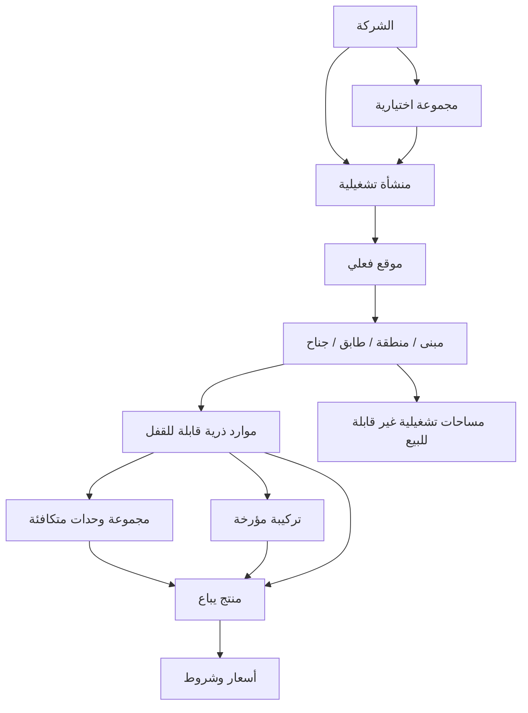

# خطة إعادة تصميم إعداد المنشأة وهيكلة العقارات

التاريخ: 22 سبتمبر 2026  
الحالة: **خطة تنفيذية مقترحة بطلب المستخدم؛ لم يبدأ تنفيذها**.  
الإصدار: **2 — مراجعة المصطلحات، حالات عدم الربط، وتجربة الإعداد**.

العلاقة بالخطة الحالية: توسع هذه الوثيقة [خطة SET](94_property_setup_and_inventory_plan.md) ولا تستبدل قرارات D أو مراحل P. وفق [سجل التنفيذ](execution/SET-progress.md) المقروء في هذه المراجعة: SET-06 مغلقة محلياً بقرار المستخدم مع تحفظ دليل RZ، وSET-07 وSET-08 متحقق منهما محلياً. هذه حالة مسجلة وليست إعادة تحقق في هذه الجلسة. PSR تحسين مقترح فوق الموجود، ولا يعيد فتح المراحل أو يضيف اعتماداً مسبقاً إليها. جميع PSR واختبارات PSR أدناه **PROPOSED / NOT_TESTED**.

حزمة التسليم للموديل المنفذ (23 سبتمبر 2026): [مواصفة الدفعة الأولى](100_psr_implementation_spec.md)، [حالات القبول](101_psr_acceptance_cases.md)، [برومبت التنفيذ](102_psr_execution_prompt.md)، [البطاقات وسجل الاستئناف](execution/PSR-progress.md). هذه المرفقات تقيد نطاق التنفيذ من التصور الواسع أدناه؛ لا يطبق المنفذ كل امتداد وارد في جدول السيناريوهات.

## 1. الهدف

بناء رحلة واحدة يستطيع من خلالها المالك أو مدير التشغيل:

1. تعريف الفندق أو المنتجع أو المجمع بصفته **منشأة تشغيلية**.
2. رسم تنظيم المكان من دون معرفة مصطلحات قاعدة البيانات.
3. إضافة غرف وفلل وشقق وأسرّة وخيام ومواقع تخييم وأكواخ وأجنحة دفعة واحدة أو منفردة.
4. تحديد ما يباع فعلياً: وحدة بعينها، فئة متكافئة، فيلا كاملة، جزء منها، سرير، جناح مركب، أو حجز كامل للمكان.
5. مشاهدة أثر كل طريقة بيع على بقية المخزون قبل الحفظ.
6. تعديل التنظيم مستقبلاً بتاريخ سريان، من دون تغيير الحجوزات أو التاريخ السابق.

المبدأ الحاكم:

> **نصف المكان مرة واحدة، ثم ننشئ فوقه طرق بيع متعددة. الحجز يقفل الذرات الفعلية التي يعتمد عليها العرض، ولا ينشئ كل عرض مخزوناً مستقلاً.**

## 2. الحدود التي لا يجوز خلطها

| المستوى | معناه | مثال | ما لا يمثله |
| --- | --- | --- | --- |
| الشركة `Tenant` | الحساب التجاري وحد العزل والأعضاء | شركة ساجارا للضيافة | فندقاً أو فرعاً |
| المجموعة `Property Group` | تجميع إداري اختياري | مجموعة فنادق بالي | مخزوناً قابلاً للحجز |
| المنشأة `Property` | وحدة تشغيل لها مكتب أمامي وتوقيت وعملة وسياسات | منتجع ساجارا | مبنى أو طابقاً |
| الموقع `Site` | عنوان أو حرم فعلي داخل المنشأة | الموقع الشاطئي، الملحق الجبلي | منشأة مستقلة ما لم تختلف عملياتها |
| عقدة المكان `Location` | منطقة/مبنى/قسم مبنى/طابق/مجموعة وحدات | مبنى A، الدور الثاني | غرفة قابلة للحجز |
| الوحدة الفعلية `Resource` | أصغر شيء يقفل عند البيع | غرفة 203، سرير B، موقع C12 | فئة تسويقية |
| المساحة الداخلية `Space` | وصف تشغيلي غير قابل للبيع بذاته | حمام، صالة، مطبخ، غرفة نوم مغلقة | مخزوناً إلا إذا اختير بيعها منفردة |
| خيار الإقامة `Product` | الوعد الذي يشتريه الضيف | غرفة ديلوكس، فيلا 4 غرف | جدراناً أو مفتاحاً |
| التركيبة `Composition` | مجموعة موارد يعتمد عليها عرض واحد | جناح = 201 + 202 | وحدة فعلية جديدة |
| مجموعة المخزون `Pool` | وحدات متكافئة يمكن للنظام اختيار واحدة منها | 20 غرفة ديلوكس | مجموعاً حسابياً للفيلا وأجزائها |
| السعر والسياسة | قيمة وشروط بيع المنتج | مرن، غير مسترد، إفطار | مخزوناً جديداً |

### متى تكون منشأة جديدة؟

يفصل المعالج بين حدود تشغيل ملزمة ومؤشرات تنظيمية:

- اختلاف العملة الأساسية أو المنطقة الزمنية أو الدفتر المالي ضمن النموذج الحالي يستلزم منشأة مستقلة؛ لا توسع ضمني للنموذج المالي.
- اختلاف مبنى أو فريق تنظيف أو موظفي استقبال أو رقم إعلان قناة وحده لا يكفي لإنشاء منشأة جديدة.
- الاستقبال المركزي قد يخدم عدة منشآت مستقلة؛ ووجود عدة فرق قد يخدم منشأة واحدة.
- تجمع المواقع المتباعدة في منشأة واحدة فقط إذا اتفقت حدود التشغيل والدفتر والتوقيت، مع عنوان وصول واضح لكل وحدة. اختلاف العنوان وحده لا يغير حد العزل.
- لا تُركّب إقامة واحدة من موارد منشأتين. الحجز المنسق بينهما يحتاج مسار مجموعة منفصل ونتائج مستقلة لكل منشأة.

مثال: منتجع بمبنى غرف ومنطقة فلل ومخيم، تديره دورة تشغيل واحدة، يمكن أن يكون منشأة واحدة. فندقان بعملتين مختلفتين يظلان منشأتين ولو امتلكهما الشخص نفسه.

## 3. النموذج العام المقترح

### 3.1 شجرة المكان

تكون `Location` شجرة اختيارية وليست قائمة مسطحة. أنواع العقد المقترحة:

- `SITE`: عنوان/حرم.
- `ZONE`: منطقة مثل الشاطئ أو الحديقة.
- `BUILDING`: مبنى أو برج.
- `WING`: قسم مبنى؛ لتجنب الخلط مع جناح الإقامة.
- `FLOOR`: طابق.
- `CLUSTER`: مجموعة فلل أو خيام.
- `SERVICE_AREA`: منطقة تشغيل فقط.

القواعد:

- كل عقدة تنتمي إلى المنشأة نفسها، ولا يسمح بالدوران.
- لا يلزم استخدام جميع المستويات؛ فندق صغير قد يبدأ بطابق ثم غرف.
- نقل وحدة بين المواقع لا يغير معرفها، ويكون بتاريخ سريان إذا تأثرت حجوزات أو تشغيل مستقبلي.
- العنوان وGPS على `Site`، وليس على كل غرفة.
- ترتيب العرض `display_order` مستقل عن الكود؛ لا يعتمد النظام على الفرز الأبجدي لأرقام الغرف.

### 3.2 الوحدة الفعلية والمساحة الداخلية

نحتاج تمييزاً واضحاً بين:

- **وحدة ذرية قابلة للقفل:** غرفة مستقلة، سرير، موقع تخييم، كرفان محدد، كابينة.
- **حاوية فعلية:** فيلا أو شقة تحتوي أجزاء؛ لا تباع كذرة ثانية إذا كان بيعها الكامل يعتمد على أجزائها.
- **مساحة تشغيلية:** صالة أو مطبخ أو غرفة نوم غير مباعة منفردة.

القاعدة العملية:

- إذا تقرر حجز الجزء منفرداً ويستطيع التشغيل دعمه، يصبح `Resource`؛ الحمام أو المدخل المشترك مسموح وصفياً ولا يُحوّل إلى وعد بخصوصية كاملة. سياسة المشاركة والوصول تُعرض وتُفرض حسب القدرة المنفذة.
- إذا كان وصفاً للمكان أو للخدمة فقط، يبقى `Space` ولا يدخل المخزون.
- بيع فيلا ذات غرف تؤجّر منفردة كاملةً ينشئ `Product + Composition` فوق غرفها القابلة للقفل، ولا ينشئ مورداً وهمياً ينافسها. أما الفيلا الكاملة فقط فلا تحتاج Composition.
- الفيلا الخاصة التي لا تؤجر غرفها منفردة يمكن تمثيلها بمورد ذري واحد، وغرف النوم مساحات وصفية.

### 3.3 سمات الوحدات

لا يُنشأ نوع مورد جديد لكل صفة. يفصل النظام بين:

- **النوع البنيوي:** ROOM، BED، SITE، CABIN ونحوها.
- **القالب:** غرفة فندقية، فيلا خاصة، فيلا مقسمة، شقة، نزل، خيمة، موقع RV.
- **السمات:** إطلالة، سرير، وصول ميسر، مسبح، طابق، تدخين، حجم، حمامات.
- **المواصفات المضمونة:** ما وعد المنتج الضيف به ويجب احترامه عند التخصيص.

تكون السمات ذات مخطط مضبوط: رمز، نوع قيمة، وحدة قياس، قابلية للبحث، وهل هي وعد مضمون أم معلومة وصفية. لا يعتمد منطق المخزون على نصوص حرة أو أسماء مترجمة.

### 3.4 أنماط الحجز — ثلاثة أبعاد مستقلة

لا تستخدم قائمة واحدة تخلط اختيار فئة بالخصوصية وبالتركيب. يختار النظام من إجابات المستخدم: (أ) وحدة واحدة أو مجموعة وحدات معاً؛ (ب) رقم محدد أو فئة متكافئة؛ (ج) استخدام خاص أو أجزاء مستقلة أو مشاركة أسرّة. قد تباع فيلا كاملة وخاصة بالرقم أو ضمن فئة فلل متشابهة. اختيار «فئة» لا ينشئ تركيبة.

الجدول التالي أمثلة لتركيبات هذه الأبعاد، وليس enum واحداً:

| الطريقة | المعنى | القفل الفعلي |
| --- | --- | --- |
| وحدة محددة | الضيف يختار رقم الوحدة | المورد المحدد |
| فئة/مجموعة | النظام يخصص واحدة من وحدات متكافئة | مورد واحد من Pool عند التخطيط |
| كامل فقط | فيلا/شقة تباع كوحدة خاصة | المورد الواحد أو جميع أوراق التركيبة |
| كامل أو أجزاء | الكامل ينافس الغرف/الأجزاء | اتحاد الموارد الذرية نفسها |
| سرير مشترك | كل سرير يباع منفرداً | مورد BED؛ الغرفة حاوية تشغيلية |
| غرفة النزل كاملة | حجز خاص لكل الأسرة | تركيبة فوق أسرّة الغرفة |
| جناح متصل | غرف محددة تباع معاً | جميع الغرف في التركيبة |
| بدائل محدودة | جناح يمكن تكوينه من أكثر من مجموعة معتمدة | اختيار بديل واحد ذرياً |
| حجز كامل للمكان | طابق/مجموعة فلل/منشأة ضمن فترة | تركيبة كبيرة ضمن حدود الأداء وموافقة تشغيلية |

لا يسمح للمستخدم برسم تركيبة اعتباطية. القوالب تنشئ قواعد معروفة، والوضع المتقدم يعرض التحذيرات واختبار الحصرية قبل الحفظ.

## 4. السيناريوهات الفعلية وحلولها

| نوع التشغيل | المشكلة المعتادة | التمثيل الصحيح | حواجز الخطأ |
| --- | --- | --- | --- |
| فندق تقليدي | خلط أرقام الغرف بفئات البيع | الغرف موارد؛ Deluxe منتج/Pool | تغيير الفئة لا يغير معرف الغرفة |
| منتجع فلل خاصة | عد غرف النوم كمخزون مستقل بلا بيع منفصل | كل فيلا مورد واحد، والغرف Spaces | لا منتجات غرف تلقائية |
| فيلا كاملة أو غرف | بيع الكامل والغرف قد يسبب ازدواجاً | غرف ذرية + تركيب للفيلا كاملة | محاكاة WHOLE/PART وprivacy acknowledgement |
| شقة Lock-off | باب داخلي يسمح A/B أو كامل | A وB موارد + تركيب AB | تحقق وصول/حمام/خصوصية لكل جزء |
| شقق فندقية | شقق بأحجام متكافئة وأرقام محددة | موارد APARTMENT + Pools حسب الفئة | لا تجميع عملات أو منشآت مختلفة |
| نزل/Hostel | الأسرة والغرفة الكاملة تتنافس | BED resources + تركيب الغرفة الخاصة | سياسة مشاركة مطبقة أو العرض محجوب |
| جناح متصل | التجاور لا يعني اتصالاً مضموناً | اختيار موارد متصلة مع علاقة موثقة | لا إنشاء جناح من مجرد أرقام متتابعة |
| خيام Glamping | الخيمة قد تكون ثابتة أو تنقل | الثابتة مورد؛ المتنقلة فئة تشغيلية مرتبطة بموقع | يمنع بيع خيمة وموقعها مرتين إذا كانا وعداً واحداً |
| مخيم/RV | الموقع له قياس وتوصيلات وأهلية | SITE resource وسمات أبعاد/كهرباء | مطابقة مواصفات المركبة كشرط أهلية |
| كبائن/أكواخ | تشبه غرفة تجارياً وفيلا تشغيلياً | مورد CABIN أو أجزاء حسب الخصوصية | القالب لا يفرض طريقة بيع واحدة |
| مبانٍ متعددة | المستخدم ينشئ منشآت كثيرة خطأً | Property واحد + Sites/Buildings | معالج يسأل عن استقلال التشغيل قبل الإنشاء |
| سلسلة فنادق | خلط الشركة بالفروع | Tenant + Groups + Properties | لا مشاركة موارد أو حجوزات بين Property |
| وحدات ملاك مختلفين | الملكية تتغير ولا تغير المكان | سجل ملكية/عقد مستقل مؤرخ | الملكية لا تمنح صلاحية مستخدم تلقائياً |
| غرفة King/Twin | إنشاء غرفتين افتراضيتين لنفس الجدران | مورد واحد + bed configuration تشغيلي | لا بيع التكوينين كمخزونين |
| غرفة لذوي الإعاقة | الصفة قد تكون وعداً ملزماً | attribute مضمونة على المنتج والمرشح | لا تخصيص مورد لا يحقق الضمان |
| غرفة موظفين/مخزن | تظهر للبيع لأنها موجودة | حاوية/مساحة أو مورد `NON_SELLABLE` | لا منتج ولا مرشح بيع تلقائي |
| صيانة موسمية | حذف الوحدة يمحو التاريخ | Block/OOO أو INACTIVE مؤرخ | لا حذف مع التزامات أو تاريخ |
| تغيير أرقام الغرف | الرقم الجديد يكسر الحجوزات والتقارير | معرف ثابت + كود/اسم مؤرخ | حفظ snapshot التاريخي للحجز |
| دمج/تقسيم وحدات | تعديل مباشر يغير الماضي | نسخة تركيب جديدة بتاريخ سريان | impact preview وحجز الحدود |
| حجز كامل المنتجع | أحجام كبيرة وأوقات وصول مختلفة | عرض مركب مضبوط أو مجموعة حجوزات | حد أوراق وأداء وموافقة؛ لا تركيب غير محدود |
| غرف عائمة/قوارب | الموقع قد يتغير لكن الوحدة ثابتة | المورد ثابت والموقع علاقة مؤرخة | لا إنشاء مورد جديد عند النقل |

### خارج نطاق الإقامة الحالي

قاعات الاجتماعات بالساعة، مواقف السيارات، معدات الإيجار، المكاتب طويلة الأجل، والمطاعم تحتاج تقاويم وتسعيراً مختلفين. لا نعلن دعمها بمجرد إضافة `resource_type`. يمكن الاحتفاظ بمكان لها في النموذج، لكن دعمها يحتاج حزمة مستقلة واختبارات زمنية ومالية.

## 5. تجربة إضافة منشأة جديدة

### المدخل

زر واحد داخل الشركة: **«إضافة منشأة»**. تظهر قبله مقارنة قصيرة:

- «إدارة منشأة مستقلة» → مراجعة حدود التوقيت والدفتر والعملة وفق §2 ثم إنشاء منشأة.
- «مبنى أو منطقة ضمن التشغيل الحالي» → إضافة موقع داخل منشأة قائمة.

هذا يمنع أكثر خطأ تنظيمي شيوعاً: إنشاء شركة أو منشأة لكل فيلا أو مبنى.

### رحلة واحدة بأربعة عناوين واضحة

لا نطلب من المستخدم اختيار «سريع/مركب». يبدأ الجميع برحلة قصيرة، وتظهر أسئلة إضافية عند الحاجة فقط. نوع المنشأة يختار أمثلة وتسميات مناسبة، ولا يفرض طريقة الحجز.

| الخطوة الظاهرة | ما يفعله المستخدم | ما يظهر عند الحاجة فقط |
| --- | --- | --- |
| 1. بيانات المنشأة | الاسم، النوع أو الأنواع، العنوان، تأكيد التوقيت والعملة المسموحين | المواقع المتعددة والاستقلال التشغيلي |
| 2. وحدات الإقامة | إضافة غرفة/فيلا/شقة/سرير/خيمة/موقع تخييم، منفرداً أو دفعة | المباني والطوابق، تفاصيل الغرف الداخلية، الاستيراد |
| 3. طريقة الحجز | «كل وحدة بمفردها» افتراضياً؛ تجميع المتشابه في فئة اختياري | كامل أو غرف، أسرّة، حجز وحدات معاً، سياسات مشاركة |
| 4. المراجعة والحفظ | مراجعة الأعداد والخصوصية وما يُحجز معاً؛ حفظ الإعداد | محاكاة التعارضات للحالات المرتبطة ونواقص التشغيل |

داخل الخطوة الثانية يكفي لفندق بسيط: «غرف» → «من 101 إلى 120» → «شخصان» → «إضافة 20 غرفة». الطوابق اختيارية ويمكن إضافتها لاحقاً. إدخال عدد غرف النوم داخل فيلا يضيف وصفاً فقط؛ لا ينشئ مخزون غرف قابلاً للحجز.

داخل الخطوة الثالثة يكون السؤال الأول: **«هل تُحجز كل وحدة بمفردها؟»**. إجابة «نعم» تنهي أسئلة الربط. إجابة «أحتاج خيارات أخرى» تعرض الخيارات الخاصة بالوحدات الموجودة، ولا تعرض أسرّة لمنشأة لم تضف غرفة مشتركة.

التشغيل والأسعار والقنوات تصبح مهام واضحة بعد حفظ الهيكل: «حدد أوقات الوصول والمغادرة»، «راجع جاهزية الوحدات»، «أضف الأسعار». لا يساوي حفظ الهيكل فتح الحجز؛ بوابة الجاهزية تمنع البيع حتى تحقق شروطه. يمكن ضبط التشغيل داخل ملخص اختياري قبل الحفظ دون زيادة الخطوات الإجبارية.

### إضافة مجموعة مختلفة

بعد إضافة غرف الفندق يظهر «إضافة وحدات أخرى» لإضافة فلل أو خيام إلى المنشأة نفسها. يحتفظ كل صف مجموعة بقالب وطريقة حجز مستقلين؛ لا تتحول غرف الفندق إلى أجزاء لمجرد إضافة فيلا قابلة للتقسيم.

### حفظ واستئناف

الحالات الظاهرة: «مسودة»، «جارٍ الحفظ»، «حُفظت المسودة»، «تعذر الحفظ — إعادة المحاولة»، «يحتاج مراجعة»، «تم حفظ الإعداد». المسودة المنفذة لا تُعاد كمسودة إنشاء؛ الإضافة أو التغيير لاحقاً له عملية مستقلة ومعاينة أثر.

عند تغير طريقة الحجز بعد إدخال أجزاء: يعرض النظام ما سيُزال من المسودة، ويحفظ بقية الإدخال حتى يؤكد المستخدم. لا حذف تلقائي لبيانات أو علاقات مستخدمة.

## 6. إضافة موقع أو وحدة بعد التشغيل

### إضافة موقع

من شاشة «تنظيم المكان»:

1. اختيار الأب.
2. اختيار نوع العقدة.
3. الاسم والكود والترتيب.
4. معاينة الوحدات التي ستنقل إليه إن وجدت.
5. حفظ فوري إذا لم يتغير المخزون، أو تغيير مؤرخ عند النقل المؤثر.

### إضافة وحدات

زر **«إضافة وحدات»** يفتح محرر الوحدات ثم طريقة الحجز والمراجعة فقط. يحتفظ بالسياق الحالي ولا يعيد إعداد المنشأة.

### تعديل طريقة بيع

لا يوجد زر تحرير مباشر لأوراق تركيبة نشطة. المسار:

1. اختيار المنتج.
2. إدخال تاريخ السريان.
3. اختيار الأوراق الجديدة.
4. معاينة الحجوزات وHolds وBlocks والتعرضات الخارجية.
5. محاكاة قبل/بعد.
6. تطبيق idempotent داخل معاملة، بنسخة مؤرخة جديدة.

### الأرشفة والحذف

- `Archive` يحفظ التاريخ ويمنع البيع الجديد بعد معالجة الالتزامات.
- الحذف متاح لمسودة لم ترتبط بأي كيان فقط.
- لا يوجد «حذف المنشآت الفارغة» اعتماداً على الاسم أو صفر الحجوزات الظاهر؛ يجب فحص الموارد والمنتجات والتدقيق والمالية والقنوات والملفات.

## 7. تصميم الواجهة

### شاشة الإعداد الرئيسية

بدلاً من تبويبات تقنية منفصلة، تكون الصفحة:

1. نظرة عامة وجاهزية.
2. المكان والوحدات.
3. طرق البيع والفئات.
4. التشغيل.
5. الأسعار والسياسات.
6. القنوات.
7. سجل التغييرات.

الأقسام التقنية الحالية تبقى في «متقدم» للمخولين، وتستخدم نفس البيانات.

### شجرة + لوحة تفاصيل

- الشجرة تعرض الموقع والمبنى والطابق والوحدة.
- النقر يفتح لوحة تفاصيل من دون مغادرة السياق.
- البحث بالكود أو الاسم أو الصفة.
- جدول الوحدات بصفوف 48–56px وصفحات 25 عنصراً واستعلام خادمي.
- إجراءات الدفعة ثابتة أعلى الجدول بعد تحديد عناصر.
- الهاتف يستخدم اختياراً متدرجاً وبطاقات، لا جدولاً مضغوطاً.

### لغة الواجهة الوظيفية

تُحفظ المفاتيح منذ البداية، لكن إضافة اللغات نفسها مؤجلة كما طلب المستخدم. النصوص لا تدخل في قواعد المجال أو الأكواد أو البصمات. الأكواد والأنواع ثابتة وغير مترجمة؛ الأسماء والوصف قابلان للترجمة لاحقاً.

## 8. الملاءمة العالمية من دون تنفيذ اللغات الآن

- البلد ISO 3166-1 والمنطقة كنص/رمز قابل للتوسعة.
- قابلية توسيع المناطق الزمنية IANA مع اختبارات تغير التوقيت الصيفي وحدود منتصف الليل؛ تظل قائمة التشغيل الحالية كما تقررها D-17 حتى اعتماد التوسعة.
- العملات العالمية امتداد مقترح يحتاج قرار نطاق متوافقاً مع D-17 واختبارات مالية؛ لا فتح جميع رموز العملات بمجرد إزالة قيد. يحفظ التصميم رمز العملة ودقتها من دون تحويل ضمني.
- التاريخ حسب منطقة المنشأة، والتخزين الزمني UTC للأحداث.
- العنوان من حقول مرنة، فلا نفرض ولاية/رمزاً بريدياً على كل دولة.
- وحدات القياس مترية/إمبراطورية للعرض؛ التخزين بوحدة معيارية.
- أرقام الهاتف E.164 عند الحاجة.
- الضرائب والفواتير والاحتفاظ ملفات سياسة منفصلة حسب الولاية القضائية؛ لا قيم عالمية مخترعة.
- أسبوع العمل، بداية اليوم المالي، وأوقات الدخول سياسات منشأة.
- لا يعتمد الفرز أو التحقق على الأبجدية أو اللغة.

## 9. أثر الباك إند المقترح

هذه قائمة تصميم، وليست تفويضاً بكتابة SQL الآن.

### تحسينات إضافية على النموذج الحالي

1. توسيع `property` ببيانات بلد وعنوان وهوية تشغيل، مع تصميم توسعة البلاد والتوقيت والعملات مستقلة، ولا تزال إزالة القيود الحالية مشروطة بقرار نطاق واختبارات متوافقة مع D-17.
2. توسيع `location` بعلاقة `parent_id` و`kind` و`display_order` و`site`، مع منع الدوران وفهارس المسار.
3. استخدام احتواء الموارد الحالي للحاويات، مع قاعدة: المورد ذو الأطفال لا يكون ورقة بيع مباشرة.
4. إضافة نموذج `space` أو سمات مساحات للحجرات غير المباعة؛ لا تحويلها إلى موارد تلقائياً.
5. فصل قالب الوحدة وطريقة التأجير عن `resource_type`، مع كتالوج سمات مضبوط.
6. إبقاء `product`, `pool`, `composition_version` محرك البيع الوحيد؛ لا جدول مخزون ثانٍ للمعالج.
7. نسخة مؤرخة للعلاقات المؤثرة في الحصرية أو الوعود، ومعرفات ثابتة للتسمية والموقع.
8. توسيع مسودة الإعداد لتخزين الشجرة والمجموعات والسياسات، ثم تحويلها إلى الكيانات القائمة في apply ذري.

### قواعد الكتابة

- كل mutation يحتاج صلاحية خادمية وCSRF و`Idempotency-Key` عند الأثر القابل للتكرار.
- Preview قراءة فقط وبصمتها تشمل revision والمدخل و`inventory_version` وحالة الأثر ذات الصلة.
- قفل المنشأة ثم إعادة التحقق قبل التطبيق.
- منع cross-tenant وcross-property بمفاتيح مركبة وRLS.
- لا تعديل هجرة مطبقة؛ forward fix مع rollback صادق أو restore runbook معلن.
- أحداث Audit تحمل before/after آمنين وcorrelation id من دون بيانات ضيف أو أسرار.
- لا endpoint يعيد جميع الوحدات بلا pagination وحدود.

## 10. العقود المقترحة

لا تُعتمد الأسماء نهائياً قبل عقد التصميم، لكن القدرات المطلوبة هي:

- قراءة/حفظ مسودة هيكل المنشأة بإصدار متفائل.
- قراءة قوالب المنشآت والوحدات وطرق البيع.
- معاينة شجرة المكان والدفعات والتركيبات.
- تطبيق الإعداد واستعادة النتيجة بالتكرار.
- إضافة/نقل/إعادة تسمية/أرشفة عقدة مكان.
- استيراد وحدات dry-run/apply.
- معاينة وتطبيق تغيير مؤرخ.
- محاكاة بيع WHOLE/PART/BED/POOL/SUITE/BUYOUT.
- تقرير جاهزية ومطابقة: موارد بلا منتج، منتجات بلا مخزون، أوراق مشتركة، نوافذ، وعود غير قابلة للتخصيص.

كل عقد يحدد permission وCSRF وIdempotency وIf-Match والأخطاء والترقيم والحدود.

## 11. حزم التنفيذ ضمن التسلسل الحالي

هذه حزم عمل داخل خطة SET وليست مراحل P جديدة:

| الحزمة | العمل | شرط البدء | بوابة الخروج |
| --- | --- | --- | --- |
| PSR-00 | جرد الحالة الأحدث وحدود الأدلة وربط القدرات الحالية بالخطة | قبل تنفيذ التحسين | مصفوفة موجود/جزئي/مقترح ومعالجة العيوب المفتوحة المؤثرة فقط |
| PSR-01 | ADR للمصطلحات وحدود Property/Site/Location/Resource/Space | PSR-00 | قرار موثق ومصفوفة تحويل |
| PSR-02 | عقد API ومسودة v2 ونموذج السمات والقوالب | PSR-01 | contracts + threat/data review |
| PSR-03 | شجرة الموقع والاحتواء والاستيراد والترحيل | PSR-02 | PG/RLS/rollback واختبارات شجرة |
| PSR-04 | طرق البيع والفئات والتركيبات والمحاكاة | PSR-03 | سيناريوهات الحصرية المختارة خضراء |
| PSR-05 | معالج واحد بأربع خطوات وخيارات تدريجية وشاشة الإعداد | PSR-04 | متصفح/هاتف/وصول وفشل شبكة |
| PSR-06 | التعديل المؤرخ والأرشفة ونقل الوحدات والمطابقة | PSR-05 | لا تغيير للماضي ولا ازدواج |
| PSR-07 | دمج النماذج في المكتب الأمامي | PSR-06 | انحدارات SET-07 وتغطية الأنماط الجديدة |
| PSR-08 | قبول شامل وترحيل بيانات تجريبية ودليل تشغيل | PSR-07 | إعادة اختبارات SET-08 المتأثرة وتحديث دليل SET-09 |

ترتيب PSR خاص بالتحسين الجديد ولا يغيّر ترتيب SET المقبول أو حالاته. يُجهَّز نموذج واجهة PSR-05 مبكراً ضمن PSR-01 للتحقق من الفهم، ثم يربط بعد العقود والخدمات. لا تعد الخطة قبولاً للقنوات أو G-13.

## 12. اختبارات القبول الإلزامية

### سيناريوهات المجال

1. فندق 200 غرفة عبر أربعة مبانٍ وثمانية طوابق.
2. 20 غرفة متكافئة بفئة واحدة وتخصيص مورد واحد فقط.
3. فيلا خاصة بأربع غرف نوم لا تباع أجزاء.
4. فيلا 4 أجزاء: بيع الكامل يمنع الأربعة، وبيع جزء يمنع الكامل حسب السياسة.
5. شقة Lock-off A/B/AB تحت سباقين متزامنين.
6. نزل 8 أسرّة مع حجز غرفة خاصة ومشاركة مطبقة.
7. جناح 201+202، مع رفض غرفة غير متصلة.
8. خيام ثابتة ومواقع تخييم بأهلية مختلفة.
9. King/Twin لنفس الغرفة من دون مضاعفة المخزون.
10. حجز كامل لطابق ضمن حد الأوراق.
11. نقل غرفة إلى مبنى جديد مع حجوزات مستقبلية.
12. تغيير رقم غرفة مع بقاء الحجز التاريخي صحيحاً.
13. تقسيم/دمج بتاريخ سريان وحجز يعبر الحد.
14. مورد غير قابل للبيع لا يظهر في البحث التجاري.
15. منتج بلا مرشح/تركيب يعرض توفر صفر ويمنع التفعيل.
16. شركتان ومنشأتان: لا تسرب في القراءة أو المعاينة أو cache.

### حالات الفشل

- إعادة الإرسال بعد فقد الاستجابة تعيد النتيجة نفسها.
- مفتاح التكرار نفسه مع payload مختلف يرفض.
- مستخدمان يعدلان المسودة؛ لا last-write-wins صامت.
- انقطاع الشبكة لا يعرض نجاحاً وهمياً.
- رد متأخر من منشأة سابقة لا يظهر بعد تغيير السياق.
- CSV مختلط لا ينشئ نصف دفعة في الوضع الذري.
- فشل apply في الورقة الأخيرة يتراجع كاملاً.
- تاريخ رجعي يحسب حسب منطقة المنشأة.
- استيراد/نقل عبر منشأة يرفض قبل الكتابة.
- تعارض Hold/Block/Commitment يغير بصمة المعاينة ويرفض القديمة.

### الأداء

- لا تحميل كامل الشجرة أو الموارد عند فتح الصفحة.
- قياس الأحجام ضمن الحدود المسموح بها أولاً؛ 5,000 وحدة هدف توسع منفصل يحتاج اعتماد الحد وقياساً مستقلاً، ولا يُفترض أن الحدود الحالية تسمح به.
- الاستعلامات الأساسية لها فهارس وخطط مقاسة، ولا N+1 عند رسم الشجرة أو المنتجات.
- التركيبات الكبيرة تخضع لحد الأوراق؛ ما يتجاوزه يستخدم مسار دفعة/عرض متخصص.

## 13. تعريف الاكتمال

لا نعتبر إعادة التصميم مكتملة لأن المعالج أنشأ صفوفاً بنجاح. يلزم:

- كل سيناريو معتمد للتنفيذ في §12 و§16 يمر عبر إنشاء، معاينة بيع، حجز، تعديل، تشغيل، وتقرير مناسب.
- لا يظهر للمستخدم Resource/Composition في الرحلة الأساسية.
- لا يوجد مورد وهمي للعرض الكامل إذا كانت له أجزاء ذرية.
- العدادات تفرق بين الوحدات الفعلية والأسرة والمنتجات ولا تجمعها كمخزون واحد.
- التعديل المؤثر مؤرخ ويحفظ الماضي.
- migration/rollback/restore مجربة على نسخة اصطناعية تحتوي بيانات قديمة.
- مراجعة مستقلة للكود والبيانات والواجهة وحكم GO.
- تبقى القنوات الحية وEX-01..05 وG-13 خارج هذا القبول المحلي.

## 14. قرارات التوسع وحدود الدفعة الأولى

1. هل تدعم المنشأة الواحدة عدة عناوين فعلية، أم يكون كل عنوان منشأة مستقلة في الإصدار الأول؟ التوصية: عدة Sites فقط إذا كان التشغيل والدفتر والتوقيت واحداً.
2. هل نحتاج `Space` ككيان مستقل أم تكفي سمات JSON مضبوطة للمساحات غير المباعة؟ التوصية: كيان خفيف إذا دخلت المساحة في التنظيف والصيانة؛ سمات إن كانت وصفاً فقط.
3. هل حجز كامل المنشأة ضمن الإصدار الأول؟ التوصية: طابق/عنقود محدود، وتأجيل منشأة كاملة كبيرة إلى عرض متخصص.
4. هل الملكية وعقود الملاك مطلوبة الآن؟ التوصية: فصلها بنيوياً وعدم إدخال المحاسبة الخاصة بالملاك قبل قرار نطاق.
5. هل البدائل المتعددة للجناح مطلوبة؟ التوصية: بدائل معلنة محدودة، لا محرك بحث تركيبات مفتوح.

حُددت خيارات الدفعة الأولى في docs/100 §1: عنوان واحد، تفاصيل وصفية بلا Space تشغيلي مستقل، وتأجيل حجز المكان بالكامل وعقود الملاك وبدائل التركيبات. الأسئلة أعلاه للتوسع اللاحق؛ لا يعيدها المنفذ كعوائق للإعداد الأساسي ولا ينفذها ضمناً.

## 15. قاموس التسميات وعقد الواجهة

التسميات التالية هي المرجع المقترح لواجهة التحسين، وتُطبَّق عند التنفيذ على القائمة والعناوين والأزرار ورسائل الخطأ والمساعدة. لا تعني إعادة تسمية جداول أو كسر عقود API.

| المفهوم | الاسم الظاهر | مثال/نص مساعدة | ما يُتجنب |
| --- | --- | --- | --- |
| Tenant | الشركة | الشركة التي تدير منشآتك | إنشاء شركة عند إضافة فيلا |
| Property | المنشأة | فندق، منتجع، مجمع شقق أو مجموعة بيوت تُدار معاً | «عقار» لكل مستوى |
| Location hierarchy | المباني والمناطق | تنظيم اختياري للوحدات | عقدة، أب، عنقود |
| Site | موقع المنشأة | عنوان إضافي ضمن المنشأة | الخلط مع موقع التخييم |
| WING | قسم المبنى | القسم الشرقي | جناح، إذا كان المقصود تنظيماً مكانياً |
| Sellable unit | وحدة إقامة | وفي الصف: غرفة 101، فيلا النخيل | مورد، ذرة |
| Space | تفاصيل الوحدة | غرف النوم والحمامات والصالة | اعتبار عدد غرف النوم عدد وحدات للبيع |
| Product | خيار الإقامة | ما يختاره الضيف عند الحجز | منتج في شاشة المالك الأساسية |
| Accommodation category | فئة الإقامة | ديلوكس — 20 غرفة متشابهة | مجموعة تعني أحياناً فئة وأحياناً تركيباً |
| Composition | حجز وحدات معاً | يُحجز جناح العائلة مع الغرفتين 201 و202 | تركيب، أوراق، سلوت |
| Whole/parts | كاملة أو غرف منفصلة | الفيلا كاملة أو غرفها | كامل/أجزاء بلا مثال |
| Private partial opening | فيلا خاصة بغرف نوم محددة | الفيلا لك وحدك؛ الغرف غير المختارة مغلقة | غرف متبقية للبيع |
| Pool selection | تخصيص الوحدة عند الحجز أو قبل الوصول | يُحجز للضيف خيار متاح يطابق الفئة | وعد بعدم حجز المخزون حتى الوصول |
| Preview | مراجعة التغييرات | ما سيُضاف أو يتغير | dry-run |
| Simulation | تجربة الحجز | تجربة بلا إنشاء حجز | إنشاء حجز تجريبي يوحي بكتابة |
| Versioned change | جدولة تغيير | يسري من تاريخ… | نسخة تركيب في الإجراء الرئيسي |

«جناح» نوع إقامة يمكن أن يكون وحدة مستقلة بلا أي ربط، أو غرفاً متصلة تُحجز معاً. يسأل المعالج أيهما المقصود، ولا يستنتج ذلك من الاسم. «مرتبط بالقنوات» حالة اتصال خارجي مستقلة تماماً عن «يُحجز مع وحدات أخرى».

### مواصفات الشاشة الأساسية

- اسم الصفحة: **«وحدات الإقامة»**، مع اسم المنشأة ومسار الموقع المختار أعلى المحتوى.
- زر رئيسي واحد: **«إضافة وحدات»**؛ بجواره قائمة ثانوية للاستيراد وتنظيم المباني والمناطق.
- جدول: **الوحدة | الفئة | المبنى/المنطقة | طريقة الحجز | السعة | الجاهزية | الإجراءات**. عنوان الصف ينطق بالنوع مثل «فيلا النخيل». المعرف الداخلي في التفاصيل فقط.
- حالتا الجاهزية والتوفر مستقلتان: غرفة نظيفة قد تكون محجوزة، ووحدة متاحة قد تحتاج تنظيفاً. لا شارة «نشطة» مبهمة تجمعهما.
- تفاصيل الوحدة: «البيانات»، «طريقة الحجز»، «التجهيز»، «سجل التغييرات». يظهر «وحدات تُحجز معها» عند وجود علاقة فقط.
- الإجراء المتكرر ظاهر، والبقية داخل «المزيد»: عرض التفاصيل، تعديل البيانات، جدولة تغيير، إيقاف الحجز، أرشفة. زر الحذف يظهر فقط عند أهلية خادمية مثبتة.
- فئة الإقامة تحرر مرة واحدة، ثم تُختار لها الوحدات المتكافئة. لا تكرار تعريف السعة والسياسات في كل صف بلا توضيح الإرث والاستثناء.

### تفاصيل النموذج

- اسم الوحدة ورقمها الظاهر مستقلان عن معرفها. يُسمح برقم 101 في مبنيين مع عرض المسار الكامل؛ يحتفظ الباك إند بكود فريد على مستوى المنشأة حتى لو تكرر رقم الباب.
- «عدد الوحدات» يولد صفوفاً؛ «عدد غرف النوم» و«عدد الأسرة داخل الغرفة الخاصة» يصفان التجهيز. لكل حقل مثال ووحدة قياس.
- للأرقام: من/إلى، بادئة، استثناءات، معاينة أول وآخر رمز. للأسماء غير الرقمية: إدخال أسطر أو استيراد، دون فرض نمط أرقام.
- الضغط على «نسخ» ينسخ التجهيز فقط؛ يسأل عن الاسم/الرقم الجديد ولا ينسخ الحجوزات أو مراجع القنوات أو الحصة أو العلاقات خفية.
- التغيير الجماعي يبيّن عدد العناصر والحقول المعدلة والاستثناءات. لا يمحو القيم المختلفة بصمت.
- الخطأ بجانب الحقل وملخص قابل للتركيز؛ أمثلة: «الرقم مستخدم في هذا المبنى»، «تغير التوفر منذ المراجعة؛ راجع الأثر مجدداً»، «لا يمكن ضم وحدة من منشأة أخرى».

### مواصفات بصرية قابلة للتحقق

يُعاد استخدام نظام الألوان والطباعة في docs/91 وdocs/92؛ لا ثيم موازٍ. شبكة مسافات 8px، نص نموذج 16px، هدف لمس 44px، صفوف 48–56px، وتباين مقاس. شاشة كبيرة: شجرة اختيارية ولوحة محتوى؛ هاتف: قائمة اختيار الموقع ثم بطاقات، مع إجراء رئيسي ثابت لا يغطي الحقول. حالات التحميل والفراغ والخطأ والحفظ واضحة؛ لا تعتمد أي حالة على اللون وحده. تُختبر لوحة المفاتيح والتركيز وقارئ الشاشة وRTL والتكبير، ولا يُعلن امتثال من التصميم وحده.

### ثلاث رحلات لاختبار الفهم

1. **فندق:** إضافة منشأة → 20 غرفة → اختيار «كل غرفة بمفردها» → فئة «ديلوكس» اختيارية → حفظ. لا سؤال عن التركيبات.
2. **فلل خاصة:** إضافة 6 فلل → 3 غرف نوم لكل فيلا → «الفيلا كاملة» → حفظ. الملخص: «6 فلل خاصة، 18 غرفة نوم وصفية؛ يمكن حجز 6 فلل كحد أقصى قبل قيود التواريخ».
3. **منتجع مختلط:** إضافة غرف ثم فلل ثم خيام → تحديد طريقة حجز كل مجموعة → تفعيل «كاملة أو غرف منفصلة» لفيلا واحدة فقط → تجربة التعارض → حفظ.

## 16. مصفوفة السيناريوهات الممتدة وعدم الربط

المعرّفات PSR-S مستقلة عن SET-AT وCAP/BR/INV/CMP ولا تستبدلها. حالات الجدول مواصفات قبول **NOT_TESTED**. «أساسي» أولوية مقترحة للتحسين، و«امتداد» لا يعلن مدعوماً حتى تنفيذ دورة التشغيل والقبول. لا يمكن ضمان جميع سيناريوهات السوق من قائمة أسماء؛ الأنماط غير المعروفة تُرفض بتفسير أو تسجل لقرار نطاق.

| المعرف | الحالة | القرار والسلوك المطلوب | النطاق المقترح |
| --- | --- | --- | --- |
| PSR-S01 | غرف مستقلة بلا فئات ولا ربط | منتج فردي لكل وحدة عند اختيار البيع بالرقم؛ لا Composition | أساسي |
| PSR-S02 | غرف متشابهة بفئة واحدة | اختيار مورد مطابق واحد؛ الفئة لا تقفل بقية غرفها | أساسي |
| PSR-S03 | جناح مبني كوحدة واحدة | مورد واحد ومساحات داخلية؛ الاسم SUITE لا يفرض ربطاً | أساسي |
| PSR-S04 | فيلا خاصة كاملة | مورد واحد؛ كل غرف النوم وصفية؛ لا مخزون أبناء | أساسي |
| PSR-S05 | فيلا خاصة مع فتح 2 من 4 غرف نوم | كل بدائل السعر تحجز خصوصية الفيلا كاملة؛ لا بيع الغرف المغلقة | امتداد عروض الخصوصية |
| PSR-S06 | فيلا تؤجر غرفها فقط | غرف فعلية مستقلة؛ لا منتج للكامل؛ حمام/صالة مشتركان موصوفان | أساسي |
| PSR-S07 | كامل أو غرف منفصلة | اتحاد غرف محددة؛ حجز أي غرفة يمنع الكامل للفترة المتقاطعة | أساسي |
| PSR-S08 | A وB منفصلان أو AB كامل | استهلاك A+B في الحجز الكامل، بدون إنشاء AB كمخزون مستقل | أساسي |
| PSR-S09 | جناح من غرفتين متصلتين | إثبات اتصال محدد؛ حجز الغرفتين في معاملة واحدة | أساسي |
| PSR-S10 | غرفتان متجاورتان بلا باب داخلي | حجز غرفتين؛ لا يُسمى جناحاً متصلاً ولا يضمن التجاور دون تخصيص | أساسي |
| PSR-S11 | جناح A+B وآخر B+C | B مشتركة؛ حجز الأول يمنع الثاني، بينما A وC قد يبقيان مستقلين | امتداد علاقات متقاطعة |
| PSR-S12 | نزل يبيع أسرّة فقط | BED ذرية والغرفة حاوية؛ سياسة مشاركة مفروضة على جميع مسارات الدخول | أساسي |
| PSR-S13 | نزل يبيع الأسرة أو الغرفة الخاصة | الغرفة الخاصة تحجز كل أسرتها؛ لا سرير افتراضي إضافي | أساسي |
| PSR-S14 | غرفتان متماثلتان في عدد الأسرة مختلفتان في المشاركة | فئات أهلية منفصلة؛ لا دمج آلي حسب السعة وحدها | أساسي |
| PSR-S15 | سرير إضافي/مهد طفل في غرفة خاصة | تجهيز أو خدمة بسعة وضوابط؛ ليس BED مستقلاً يباع لنزيل آخر | أساسي وصفياً؛ مخزون التجهيز امتداد |
| PSR-S16 | King/Twin لنفس الغرفة | مورد واحد وتكوين مطلوب ووقت تجهيز؛ كلا العرضين يتنافسان عليه | امتداد ضمان التجهيز |
| PSR-S17 | منتجع يجمع غرفاً وفللاً وخياماً | كل مجموعة لها طريقة مستقلة؛ نوع المنتجع لا يفرض ربطاً | أساسي |
| PSR-S18 | خيمة ثابتة تستهلك موقعاً يمكن تأجيره خالياً | حصرية مشتركة معلنة؛ لا مخزونان مستقلان لنفس البقعة | امتداد |
| PSR-S19 | مخيم بمواقع مرقمة | كل بقعة وحدة؛ أبعاد وتوصيلات وأهلية محفوظة | أساسي للبقع؛ فرض الأهلية يحتاج اختباراً |
| PSR-S20 | مخيم مفتوح بسعة عددية بلا بقع محددة | لا اختراع أرقام بقع؛ يحتاج نموذج مخزون كمي مستقل | مؤجل |
| PSR-S21 | فئة فلل كاملة وكل فيلا لها غرف | اختيار بديل فيلا واحدة ثم جميع أوراقها، وليس جمع جميع فلل الفئة | امتداد بدائل محدودة |
| PSR-S22 | حجز طابق أو مجموعة فلل بالكامل | قائمة موارد مؤرخة، لا استعلام حي يضيف كل غرفة جديدة للحجز القديم | امتداد محدود الحجم |
| PSR-S23 | حجز جماعي لأسر مستقلة | عناصر حجز متعددة؛ ليست Composition لمجرد حجزها معاً | يستخدم مسار المجموعات القائم |
| PSR-S24 | شقق موزعة بعناوين مختلفة | عنوان الوصول على كل موقع ووحدة؛ شفافية الموقع الموعود عند الحجز | امتداد مواقع متعددة |
| PSR-S25 | مالك يستخدم وحدته أو عقد إدارة موسمي | فترة حجب/صلاحية إدارة؛ لا حذف ولا تغيير مالك Tenant | الحجب قائم؛ عقود الإدارة امتداد |
| PSR-S26 | مسبح أو ممر أو مطبخ مشترك | مرفق وصلاحية استخدام؛ لا يقفل المكان كله مع كل حجز | أساسي وصفياً |
| PSR-S27 | حجز مسبح خاص حصري مرتبط بوحدتين | يحتاج حصرية إضافية صريحة؛ لا يُعامل كمرفق مشترك | مؤجل حتى نموذج موثق |
| PSR-S28 | تغيير فئة الغرفة أو وعودها | تاريخ سريان؛ لا تخصيص بديل يخالف وعد حجز قديم | أساسي في التغيير |
| PSR-S29 | تغيير كامل فقط إلى كامل/غرف | انتقال ذرة واحدة إلى عدة ذرات؛ خطة تحويل التزامات أو رفض آمن | امتداد ترحيل حساس |
| PSR-S30 | التحول من أجزاء إلى كامل فقط | إيقاف عروض الأجزاء مؤرخاً؛ حفظ حجوزاتها وعدم حذف مواردها | امتداد ترحيل حساس |
| PSR-S31 | إقامة شهرين أو موسمية | نفس حصرية الليالي واستمرارية المورد؛ التسعير طويل الإقامة مستقل | ضمن حدود المدة الحالية |
| PSR-S32 | إقامة بالساعات أو day-use | لا تقريبها لليلة؛ يحتاج تقويم فترات ووقت تجهيز وتعارضات | مؤجل |
| PSR-S33 | تقسيم إقامة بين غرفتين | موافقة وخطة StaySegments صريحة؛ لا تبديل غرفة كل ليلة خفية | يستخدم القدرة القائمة إذا اختبرت |
| PSR-S34 | تغيير اسم/رقم/مكان | معرف ثابت وتدقيق؛ انتقال بين Property ليس مجرد نقل موقع | أساسي |

## 17. ثوابت تمنع أخطاء التركيب

- **PSR-INV01 — استقلال المحاور:** الاحتواء الفعلي، الموقع، فئة الإقامة والحجز معاً علاقات مختلفة؛ تعديل إحداها لا يعدل البقية ضمنياً.
- **PSR-INV02 — الهوية:** الفيلا الحاوية تظل مفهومة تشغيلياً حتى إن لم تكن مورداً ذرياً. يربط المخطط القادم الهوية والحاوية والأجزاء صراحة؛ لا إنشاء parent قابل للبيع لمجرد رسمه في الشجرة.
- **PSR-INV03 — التحويل بين الكامل والأجزاء:** لا تكفي إضافة نسخة تركيب عند وجود حجز قديم على مورد الفيلا الواحد. حتى تطوير تحويل ذري يربط الالتزام القديم بكل الأجزاء، يرفض التحويل في الفترات المتأثرة. يمنع بيع الأجزاء تحت الحجز القديم ولو اختلفت resource IDs.
- **PSR-INV04 — الخصوصية:** «غرف مفتوحة للخدمة» مستقلة عن «موارد محجوزة حصرياً». الفيلا الخاصة تظل غير متاحة لضيف آخر ولو فُتحت غرفة واحدة.
- **PSR-INV05 — البدائل:** لكل وحدة مجمعة أوراق معلنة؛ فئة الفلل تختار بديلاً كاملاً واحداً. لا تصنع فيلا من غرفة في مبنى A وأخرى في مبنى B.
- **PSR-INV06 — السعة:** السعة المباعة والوعد بالأسرة والسعة الآمنة والتكوينات حقول مستقلة. لا جمع آلي لسعات الموارد المشتركة؛ قيمة معلنة تتحقق مقابل التكوين. عند توفر جزئي أو معلومات ناقصة تكون النتيجة غير قابلة للبيع حتى المعالجة.
- **PSR-INV07 — الاستمرارية:** إثبات نفس الخيار الصالح طوال الإقامة؛ وجود غرفة متاحة كل ليلة لا يكفي إذا اختلفت الغرفة بلا Split Stay مصرح.
- **PSR-INV08 — الصيانة والتجهيز:** حجب الجزء يمنع الخيارات التي تتطلبه؛ حجب الأب يطبق على نطاق ذري معلوم. لا تتحول الغرف الشقيقة إلى متاحة بسبب حذف الأب أو إعادة تسميته.
- **PSR-INV09 — الزمن:** فترات الإقامة نصف مفتوحة [الوصول، المغادرة)؛ نوافذ إعداد النسخ تتبع عقد المشروع القائم مع تحويل صريح للحدود. يجب اختبار ليلة تقع قبل تاريخ التغيير وبعده وإقامة تعبره؛ لا تغيير معنى effective_to ضمنياً.
- **PSR-INV10 — التاريخ:** يبقى snapshot الوعد والنسخة والتخصيص للحجز؛ لا يغير تعديل الموقع/الفئة تفاصيله الماضية. يشرح تقرير المطابقة فرق الإعداد الحالي والالتزام التاريخي ولا يصف اختلافاً مشروعاً كفساد.
- **PSR-INV11 — القنوات:** الحصرية المحلية لا تعني عرض الكامل والأجزاء المتنافسة خارجياً معاً. D-20 وحالة الحصة وأدلة السحب حاكمة لكل تغيير؛ المحاكاة تفصل المحلي عن ما تسمح به القناة.
- **PSR-INV12 — العدادات:** «6 فلل، 18 غرفة نوم، 12 خيار إقامة» ثلاثة مقاييس مختلفة. لا يعرض مجموعها كتوافر؛ التوفر مرتبط بالفترة والمنتج والحصة.
- **PSR-INV13 — الإلغاء:** إلغاء حجز لا يفتح مورداً ما زال محجوباً أو تحت حصة خارجية أو حجز آخر. إعادة الحجز والإلغاء idempotent وتحت القيود نفسها.
- **PSR-INV14 — دورة الحياة:** مسودة الهيكل، أهلية الحجز، الجاهزية التشغيلية، والاتصال بالقنوات حالات مستقلة. «تم حفظ الإعداد» لا تعني اكتمال التشغيل.

## 18. قبول تجربة الاستخدام والتتبع

| المعيار | الاختبار المطلوب | الارتباط |
| --- | --- | --- |
| PSR-UX01 | مستخدم جديد يضيف غرفاً مستقلة دون ظهور مصطلحات تركيب أو أوراق أو مورد | S01/S02؛ PSR-05 |
| PSR-UX02 | إدخال 4 غرف نوم لفيلا كاملة لا ينشئ 4 منتجات أو 4 موارد بيع | S04؛ INV02/04 |
| PSR-UX03 | مستخدم يشرح بعد الملخص ما الذي يتوقف عن الحجز عند بيع الكامل أو غرفة | S07/S08؛ INV04 |
| PSR-UX04 | إضافة غرف ثم خيام تحفظ طريقة مستقلة لكل مجموعة | S17؛ INV01 |
| PSR-UX05 | يجد المستخدم المنشأة والوحدة وعنوان الوصول دون الاطلاع على UUID | S24/S34؛ PSR-05 |
| PSR-UX06 | تغيير السياق أثناء تحميل بطيء لا يعرض بيانات المنشأة السابقة | SET isolation؛ PSR-08 |
| PSR-UX07 | إتمام الرحلات الثلاث بلوحة مفاتيح وهاتف 390px وتكبير 200% | PSR-05/08 |
| PSR-UX08 | بعد فقد استجابة الحفظ تظهر النتيجة المسترجعة دون إنشاء وحدات إضافية | SET-AT01؛ PSR-02/08 |

اختبار فهم مقترح مع خمسة مستخدمين يمثلون فندقاً وفللاً ومنتجعاً مختلطاً ونزلاً وشققاً: ينفذ كل منهم الإضافة والتعديل ويشرح الفرق بين عدد غرف النوم والوحدات المتاحة دون مساعدة. هدف القبول المقترح نجاح 4 من 5 دون تدخل، وصفر سوء فهم يؤدي إلى بيع مزدوج أو فقد خصوصية. يسجل الوقت والأخطاء لكل رحلة لتحسينها؛ لا تُنسب هذه النتائج لاختبار متصفح آلي، ولم ينفذ الاختبار الآن.

قبل كل بطاقة PSR يكتب المنفذ: السيناريوهات PSR-S المختارة، والثوابت PSR-INV المتأثرة، وروابط CAP/BR/INV/CMP وSET-AT الأصلية التي تنطبق بعد مراجعتها، ومصفوفة واجهة/API/DB/مخزون/تشغيل/تقارير/قنوات. أسماء الأنماط والأسئلة هنا مقترحة للتنفيذ؛ لا يُعاد استخدام enum قائم بمعنى جديد. تُحفظ توافقية المسودات بإصدار مخطط وتحويل صريح أو رفض قابل للاستئناف، ولا يعاد تنفيذ مسودة مكتملة.

### سجل تنقيح الإصدار 2

- فصل الفئة عن التركيبة، وإضافة «لا ربط» و«جناح مستقل» و«غرف فقط» كحالات أصلية.
- اختصار الرحلة من سبع خطوات إجبارية إلى أربع بخيارات تظهر حسب الحاجة.
- تصحيح معيار المنشأة المستقلة، وتسميات الموقع وموقع التخييم والجناح.
- إضافة تحويل الكامل/الأجزاء، الخصوصية الجزئية، البدائل والمرافق المشتركة وحدود القنوات.
- اعتماد 34 سيناريو تصميمياً مع حدود أساسي/امتداد/مؤجل؛ كلها NOT_TESTED في سياق PSR.
- تصحيح التبعية التاريخية SET-06/07/08 من السجل الحالي دون ادعاء إعادة فحص أو تغيير قرارات القبول.
- نطاق هذه المراجعة وثائق وتصميم رحلة فقط؛ لا دليل على تغيير الواجهة الفعلية أو دعم السيناريوهات الجديدة بعد.
